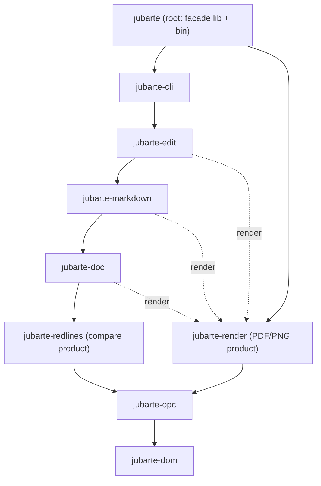

# Jubarte Workspace Split Implementation Plan (v5)

> **For agentic workers:** REQUIRED SUB-SKILL: use subagent-driven-development (recommended) or executing-plans to implement this plan task by task. Steps use checkbox (`- [ ]`) syntax for tracking. The plan ships as a `gh stack` (one layer per task). No task waits for CI/CD except the last task of each phase.

**Goal:** Split the single published crate (package `jubarte-redlines`, library `jubarte`) into a layered Cargo workspace so that compare-only and render-only consumers stop compiling and linking each other's code, while every `jubarte::` public path and every output byte stay the same.

**Architecture:** Eight library crates under `crates/` in a strict downward DAG (dom, opc, then the two peer products redlines and render, then doc, markdown, edit, cli), plus the root package as a facade that re-exports the whole surface and builds the `jubarte` binary. Modules move bottom-up, one crate per task, with the monolith remainder compiling through module re-exports at every step. The bindings (`jubarte-wasm`, `jubarte-python`, `jubarte-rust-inproc`, `fuzz`) stay standalone workspaces and select sub-crates by feature.

**Tech stack:** Rust edition 2024, MSRV 1.94, Cargo workspace (resolver 3), cargo-nextest, cargo-semver-checks, criterion, wasm-pack, maturin/PyO3, the mbx build cache.

**Spec:** Part A of this document. It supersedes v4, kept beside this file as `implementation_plan_v4.md`. Also read `AGENTS.md` and `~/T/reconciliation_plan/GET_JUBARTE_RUST.md` (named by `AGENTS.md`; outside this repository and not reviewed while writing this plan) before the first task.

---

## Evidence baseline (HEAD `1d90289e5`, measured 2026-11-14)

Everything below was measured by static inspection (`wc`, `grep`, small Python scans). No `cargo` command was run, so compile-dependent facts are marked "confirm in T0".

| Fact | Value | How to reproduce |
| :--- | :--- | :--- |
| `src/` size | 166 `.rs` files, 374,907 lines | `find src -name '*.rs' \| xargs cat \| wc -l` |
| Lines by target layer | dom 9,031; opc 11,776; redlines 110,030; render 89,530; doc 29,522; markdown 59,910; edit 48,653; cli 7,989; facade and bin 8,466 | map each file with `MODULES` in `tests/crate_layering.rs` |
| Five largest files | `convert/mod.rs` 69,285; `comparer/finalize.rs` 35,455; `comparer/lcs.rs` 21,070; `document_comparer.rs` 14,888; `edit.rs` 12,330 (153,028 lines, 40.8%) | `wc -l` |
| Integration tests | 596 files in `tests/*.rs`, 262,713 lines; 222 declare `mod common;` | `ls tests/*.rs \| wc -l` |
| Published identity | package `jubarte-redlines` 0.18.0, `[lib] name = "jubarte"`; PyPI `jubarte-redlines`; npm `jubarte-wasm` and `jubarte-redlines` | root `Cargo.toml`, `jubarte-python/pyproject.toml`, `jubarte-wasm/{npm,cli}/package.json` |
| Root release profile | none declared; release CI sets no LTO | `grep -n profile Cargo.toml` |
| Binding profiles | wasm and inproc: `lto = true`, `codegen-units = 1`, `strip = "symbols"`, `panic = "abort"`; python: `lto = true`, `codegen-units = 1`, `strip = "none"`, unwinding | the three binding `Cargo.toml` files |
| WASM artifacts | full 23,163,493 bytes; slim 23,112,788 bytes | `ls -l jubarte-wasm/npm/*/jubarte_wasm_bg.wasm` |
| Embedded fonts | `assets/fonts/` is 7.9 MB on disk including `extra/`; 16 embedded TTFs plus 2 license files; release archives and `install.sh` read only `assets/fonts/extra/*.ttf` | `du -sh assets/fonts`; `release.yml:161`; `scripts/install.sh:34` |
| Layering guard | static replica finds 16 upward edges; `KNOWN_UPWARD` lists 13. The 3 unlisted: `src/append.rs -> markdown::package` (line 1044), `src/convert/mod.rs -> comparer` (19037, 22384, 22389, 22425), `src/document_comparer.rs -> validate` (597, 598, 8814). The guard should be red at HEAD (confirm in T0.2) | replicate `upward_edges` from `tests/crate_layering.rs` |
| Restricted-visibility items | 1,210 `pub(crate)` / `pub(super)` / `pub(in …)` items; up to 388 names also occur in another layer (name-match upper bound) | regex scan |
| `#[cfg(test)]` helpers used across layers | `admission::zip_names`, `admission::limit_test_support`, `convert::font::bundled`, `convert::font::resolve_in`, `inspect::reset_reopened_packages`, `xmllinq::shrink_arena_to_fit` | regex scan |
| Feature cfg sites | `perf-profile`: 20 in the dom layer, plus `lib.rs` and `capabilities.rs`; `cli`: 3 in `edit/inline.rs` | `grep -rn 'feature = "'  src` |

## Corrections to v4

| v4 statement | Measured | Consequence in v5 |
| :--- | :--- | :--- |
| 315k LOC, 122 files, 595 tests | 374,907 lines, 166 files, 596 tests | numbers replaced; `crate_layering.rs` is the 596th |
| "17 MB of uncompressed TTF fonts" | 7.9 MB on disk | size targets are measured, never assumed |
| slim WASM shrinks "from 23 MB to ~4 MB" | no measurement supports 4 MB | AC is "renderer and fonts absent" plus a recorded size |
| Rows 2 and 6 "Done (in-crate)" | bodies moved, call sites still use the old upward paths; guard red | T0.2 |
| Matrix lists every upward reference | misses `audit.rs:28` (uses `convert`), the `#[cfg(test)]` helper crossings, feature forwarding, intra-doc links to upper layers | T2.1, T2.5, A5, A6 |
| `oxml-opc` supplies "4 trivial types" | `PartFs` is built on `oxml_opc::OpcPackage` and `ContentTypes`; `OpcError` and `Relationship` are public re-exports; `Relationships` derefs to the upstream type; the cited doc describes migrating *to* oxml-opc; `chrono` is not in `Cargo.lock` | retirement deferred (W1) |
| `#[doc(inline)]` makes re-exported sub-crate items appear in rustdoc JSON `index` | rustdoc JSON never inlines foreign items; cargo-semver-checks cannot follow cross-crate re-exports | semver and API gates redesigned (A7, T4.0) |
| Unified workspace only needs `strip = "none"` at the root | profiles are read only at the workspace root and `panic`/`lto`/`rpath` cannot be set per package; the bindings need three different combinations | bindings stay standalone (D2) |
| `tests/wasm_crate_is_self_contained.rs` is a standalone gate | file does not exist | dropped |
| 111 relative `include_*!` calls in tests | 104 in 40 files, plus 1 `concat!(env!("CARGO_MANIFEST_DIR"), …)` | T1.1 |
| test moves need only `mod common;` and `include_*!` rewrites | 9 `#[path = "common/…"]` attributes also break | T1.1 |
| `it_security` and `it_dom_opc` membership ("…, etc.") | not reproducible | deterministic layer rule (A8) |
| `update.rs:44` holds an `include_bytes!` to rebase; `keys/` exists | line 44 is a doc comment; there is no `keys/` directory | dropped |
| Eight root reports to archive, "all still at repo root" | only `ISSUE_TRIAGE_REPORT.md` exists | T6.3 |
| `[tool.maturin] packages = […]` | key not verified; maturin 1.x documents `python-packages` | T5.3 measures the wheel contents |
| Phases 1, 2, 4, 5, 6 | no phase performs the split itself | Phase 4 |

## Decisions

Each decision has a default that the tasks implement. Changing one touches only the tasks named.

| # | Decision | Default | Alternative and what it changes |
| :--- | :--- | :--- | :--- |
| D1 | Crate names | v4 naming: root package becomes `jubarte`; the compare product takes the existing name `jubarte-redlines` (lib `jubarte_redlines`). This is a breaking repurposing of a published name, released as 0.19.0 with a migration note | If `jubarte` is unavailable on crates.io (T0.1), or the owner prefers no break: root stays `jubarte-redlines`, compare crate is `jubarte-compare`. Skip T4.3a; rename in T4.3b, T5, T6.2 |
| D2 | Bindings and the root workspace | `jubarte-wasm`, `jubarte-python`, `jubarte-rust-inproc`, `fuzz` remain standalone workspaces with their own lockfiles and profiles | Unify later (W2) after a spike proves custom profiles through wasm-pack and maturin |
| D3 | `oxml-opc` retirement | out of scope (W1) | separate ADR and plan |
| D4 | Cross-crate internals | promote to `#[doc(hidden)] pub` at the existing path; sibling crates pin each other with `=` versions. No `__private` module, because it would force rewriting call sites that otherwise keep compiling through module re-exports | `__private` modules, at the cost of editing every call site |
| D5 | `render` feature on doc, markdown, edit, cli | off by default (`default = []`); the facade turns it on; every crate forwards it | default-on, which lets one forgotten `default-features = false` silently re-link the renderer |
| D6 | Embedded fonts and schema | move the 16 TTFs and 2 licenses to `crates/jubarte-render/assets/fonts/`; move `edit-plan-v2.schema.json` to `crates/jubarte-edit/schemas/`; `assets/fonts/extra/` stays at the root | keep root copies plus a byte-equality test |
| D7 | Test suites | 7 suites by highest layer referenced (A8) | n/a |
| D8 | Release profile | unchanged unless the benchmark gate (T4.3b AC4) fails, then `lto = "thin"` at the root | n/a |
| D9 | Path rewriting | none; each crate re-exports the lower crates' modules under their old names so `crate::<module>` paths compile unchanged | mass rewrite (W3) |

## Global Constraints

- Word parity first (`AGENTS.md`). This plan moves code; it changes no behavior. Any diff in a golden, a fixture output or a recorded sha256 is a defect in the task that produced it.
- Every `jubarte::` public item path that exists at the baseline exists after every task, with the same kind and signature (measured by T4.0 AC2).
- Run Cargo from the repository root, one Cargo process at a time per checkout, through mbx. Never set `CARGO_TARGET_DIR`, never `cargo clean`, never `rm -rf target` (`AGENTS.md`).
- Scratch output goes under `.scratch/split/`.
- No `#[allow(...)]` to silence clippy; `tests/common/mod.rs` keeps its existing `#![allow(dead_code)]`.
- Move files with `git mv`. A task that moves code makes no other edit to the moved lines beyond what its steps name.
- Tests run with `cargo nextest run`; doctests with `cargo test --doc`.
- Edition 2024, `rust-version = "1.94"`, license `AGPL-3.0-only`, SPDX headers on every new file (REUSE).
- No release is cut from any commit between T4.3a and the end of Phase 6. Patch releases of 0.18 come from a `release/0.18` branch.
- No em dashes in docs or commit messages.

## Review Focus

Failure modes this refactor can introduce that ordinary unit tests do not catch. Each has a measurer in the task that owns it.

1. The slim WASM build links the renderer again through Cargo feature unification, with no error. Owner: T5.1 AC1 and AC2.
2. A test file is moved but not declared in its suite's `main.rs`, so its tests silently stop compiling. Owner: T1.1 AC1 and AC2.
3. A public `jubarte::` path disappears or changes kind, unseen because the semver tool cannot follow facade re-exports. Owner: T4.0 AC2, checked in every Phase 4 task.
4. Compare gets slower for crates.io consumers because calls that were inlined inside one crate now cross a crate boundary without LTO. Owner: T4.3b AC4, T4.9 AC4.
5. A published sub-crate does not build from its tarball because an embedded asset lives outside its directory. Owner: T4.4 AC3, T4.7 AC3, T4.9 AC3.

---

# Part A: Specification

## A1. Dependency DAG

Strictly acyclic in `[dependencies]` and in `[dev-dependencies]`. Dotted edges exist only with the `render` feature.



Each crate may also depend directly on any crate below it. `jubarte-redlines` and `jubarte-render` never depend on each other.

## A2. Crates

Module lists come from `MODULES` in `tests/crate_layering.rs`. External dependency lists are the expected starting point; `cargo check -p <crate>` decides.

| Crate (path `crates/<name>`) | Lib name | Modules | Expected external deps |
| :--- | :--- | :--- | :--- |
| `jubarte-dom` | `jubarte_dom` | `xmllinq`, `namespaces`, `ids`, `unid`, `perf`, `util`, `ooxml`, `limits` | `quick-xml` 0.42, `foldhash`, `unicode-segmentation`, `unicode-properties`, `serde`, `serde_json`, `sha2`, `js-sys` (wasm32-unknown only) |
| `jubarte-opc` | `jubarte_opc` | `opc`, `admission`, `markup_simplifier`, `strict_translation`, `settings`, `word_default_theme`, `builtin_styles`, `borders`, `data_stores`, `validate_dom`, `render_options` (T2.5), `numbering` and `table_dom` (T2.4) | `oxml-opc` 0.14.4, `quick-xml` 0.41 (alias `quick-xml-041`), `zip` 9.0.5, `sha1`, `sha2`, `serde`, `serde_json` |
| `jubarte-redlines` | `jubarte_redlines` | `comparer`, `document_comparer`, `revision_processor`, `wml_document`, `comparison_log` | `serde`, `serde_json`, `sha1`, `sha2`, `base64` |
| `jubarte-render` | `jubarte_render` | `convert` | `ttf-parser`, `rustybuzz`, `tiny-skia`, `image`, `flate2`, `serde`, `serde_json` |
| `jubarte-doc` | `jubarte_doc` | `changes`, `comments`, `comment_settlement`, `validate`, `audit`, `scrub`, `append`, `fields`, `debug`, `inspect` | `serde`, `serde_json`, `sha2` |
| `jubarte-markdown` | `jubarte_markdown` | `markdown` (without `patch`, `redline`, `unified`), `legacy_doc` | `pulldown-cmark`, `similar`, `regex`, `base64`, `serde`, `serde_json`, `sha2` |
| `jubarte-edit` | `jubarte_edit` | `edit` (without `inline`), `markdown::{patch, redline, unified}`, `text_diff`, `expect`, `capabilities`, `publication`, `result` | `schemars`, `similar`, `regex`, `serde`, `serde_json`, `sha2`, `cap-std` and `uuid` (non-wasm), `xattr` (unix non-wasm) |
| `jubarte-cli` | `jubarte_cli` | `cli`, `update`, `edit::inline` (as `inline`); owns `build.rs` (`JUBARTE_BUILD_VERSION` is read in `cli.rs`) | `clap`, `same-file`, `self_update` and `ed25519-dalek` (feature `self-update`) |
| `jubarte` (root) | `jubarte` | `src/lib.rs` (re-exports only), `src/bin/**`, `benches/`, `examples/`, `tests/` | `mimalloc` (feature `fast-alloc`) |

The two product crates publicly re-export the lower modules whose types appear in their signatures (`jubarte_redlines::{admission, opc, strict_translation, xmllinq, namespaces}`, `jubarte_render::{admission, opc}`) so a standalone user needs one dependency.

## A3. Workspace manifest

```toml
[workspace]
resolver = "3"
members = [".", "crates/*"]
exclude = ["jubarte-python", "jubarte-wasm", "jubarte-rust-inproc", "fuzz"]

[workspace.package]
version = "0.18.0"            # the release script bumps this and the "=" pins together
edition = "2024"
rust-version = "1.94"
authors = ["Jandira Technologies, LLC"]
license = "AGPL-3.0-only"
repository = "https://github.com/jandira-tech/jubarte-redlines"

[workspace.dependencies]
jubarte-dom      = { path = "crates/jubarte-dom",      version = "=0.18.0" }
jubarte-opc      = { path = "crates/jubarte-opc",      version = "=0.18.0" }
jubarte-redlines = { path = "crates/jubarte-redlines", version = "=0.18.0" }
jubarte-render   = { path = "crates/jubarte-render",   version = "=0.18.0" }
jubarte-doc      = { path = "crates/jubarte-doc",      version = "=0.18.0", default-features = false }
jubarte-markdown = { path = "crates/jubarte-markdown", version = "=0.18.0", default-features = false }
jubarte-edit     = { path = "crates/jubarte-edit",     version = "=0.18.0", default-features = false }
jubarte-cli      = { path = "crates/jubarte-cli",      version = "=0.18.0", default-features = false }
# third-party entries: copy each line of today's [dependencies] verbatim, comments included

[workspace.lints.rust]    # today's [lints.rust] table, moved verbatim
[workspace.lints.clippy]  # today's [lints.clippy] table, moved verbatim
```

T4.0 applies these tables with `members = ["."]` only: the `crates/*` glob matches nothing until T4.1 creates the first crate, and an unmatched member glob fails `cargo metadata` (T4.0 AC1). T4.1 adds `"crates/*"` to `members` in the same commit that creates `crates/jubarte-dom`.

Every member sets `version.workspace = true`, `edition.workspace = true`, `rust-version.workspace = true`, `license.workspace = true`, `repository.workspace = true`, `[lints] workspace = true`, and its own `description`, `readme`, `keywords` (at most 5), `categories`, anchored `include`, and `[package.metadata.docs.rs] all-features = true`. Each crate directory holds a real copy of `LICENSE` and a short `README.md`. Each `lib.rs` starts with the attributes the root has today: `#![cfg_attr(all(coverage_nightly, test), feature(coverage_attribute))]`, `#![forbid(unsafe_code)]`, `#![warn(missing_docs)]`.

`[package.metadata.release-notes]` and `[patch.crates-io]` stay in the root manifest. The cargo-semver-checks deny table must apply to every published crate; keep `scripts/semver_lints.py` passing for each.

Why exact pins: the sub-crates expose `#[doc(hidden)] pub` internals to each other (D4). Exact pins mean those internals never have to be compatible across versions.

## A4. Features

| Crate | Features |
| :--- | :--- |
| `jubarte-dom` | `perf-profile`, `test-support` |
| `jubarte-opc` | `perf-profile = ["jubarte-dom/perf-profile"]`, `test-support = ["jubarte-dom/test-support"]` |
| `jubarte-redlines`, `jubarte-render` | `test-support` (forwarding down); `perf-profile` forward if the crate has a cfg site |
| `jubarte-doc` | `default = []`; `render = ["dep:jubarte-render"]`; `test-support` |
| `jubarte-markdown` | `default = []`; `render = ["dep:jubarte-render", "jubarte-doc/render"]` |
| `jubarte-edit` | `default = []`; `render = ["dep:jubarte-render", "jubarte-doc/render", "jubarte-markdown/render"]`; `perf-profile` forward (`capabilities.rs`) |
| `jubarte-cli` | `default = []`; `render = ["jubarte-doc/render", "jubarte-markdown/render", "jubarte-edit/render"]`; `self-update = ["dep:self_update", "dep:ed25519-dalek"]` |
| `jubarte` | `default = ["cli", "fast-alloc", "self-update"]`; `cli = ["dep:jubarte-cli", "jubarte-cli/render"]`; `fast-alloc = ["cli", "dep:mimalloc"]`; `self-update = ["cli", "jubarte-cli/self-update"]`; `perf-profile` forwards to every crate that declares it. The seven library crates below `jubarte-cli` are unconditional dependencies with `render` enabled, so `--no-default-features` builds the same library as today |

Rules. Features are additive. A crate that has a `cfg(feature = "X")` site declares `X` and forwards it to every dependency that declares `X`. With `render` off, a public item that needs layout does not exist (it carries `#[cfg(feature = "render")]`); there are no runtime "unsupported" stubs. Known sites: `markdown::page_texts` (`markdown/mod.rs:1113`), `fields.rs:79, 170, 257`, `audit.rs:28`, `debug/render.rs:1158-1162`. The pure option types move to `jubarte-opc::render_options` and exist in both configurations.

`test-support` exposes the `#[cfg(test)]` helpers listed in the baseline as `#[cfg(any(test, feature = "test-support"))] #[doc(hidden)] pub`. An upper crate enables it only in `[dev-dependencies]`. It is undocumented and carries no stability promise.

## A5. Visibility, shims and doc links

- V1. An item that another crate needs and that is fit to be API becomes `pub` with documentation.
- V2. Any other item that another crate needs becomes `#[doc(hidden)] pub` at its existing path, with a one-line comment naming the consumer crate. Root modules that are private today (`limits`, `ooxml`, `builtin_styles`, `word_default_theme`) become `#[doc(hidden)] pub mod` in their new crate.
- V3. An inherent `impl` block lives in the crate that defines the type. A trait impl needs the trait or the implementing type to be local. The static scan found no violation (three `impl From<LocalCliType> for <lower type>` blocks in `cli.rs` and one `impl From<ProgressEvent> for serde_json::Value` in `result.rs`, all legal); the compiler is the final check.
- Shims. Each crate's `lib.rs` re-exports the lower crates' modules under their old names, for example in `jubarte-redlines`: `pub use jubarte_opc::{admission, opc, strict_translation}; pub(crate) use jubarte_opc::{markup_simplifier, settings, validate_dom, /* … */}; pub(crate) use jubarte_dom::{util, ooxml, limits, /* … */};`. Existing `crate::<module>::…` paths then compile unchanged. Do not rewrite paths.
- Doc links. A crate cannot link to an item in a crate above it. Replace such intra-doc links with the plain backticked path (`` `jubarte::edit::apply_plan_json` ``).

## A6. Facade

`src/lib.rs` keeps today's crate documentation and contains only re-exports, each with `#[doc(inline)]` so docs.rs renders the items inside the `jubarte` documentation:

```rust
#[doc(inline)] pub use jubarte_dom::{ids, namespaces, perf, unid, util, xmllinq};
#[doc(inline)] pub use jubarte_opc::{admission, markup_simplifier, opc, settings, strict_translation};
#[doc(inline)] pub use jubarte_redlines::{comparer, comparison_log, revision_processor, wml_document, WmlDocument};
#[doc(inline)] pub use jubarte_render::convert;
// … one line per crate; modules that are public today and no others
```

Three modules are composed, because part of their public surface lives in a higher crate:

```rust
pub mod document_comparer {
    #[doc(inline)] pub use jubarte_redlines::document_comparer::*;
    #[doc(inline)] pub use jubarte_doc::changes::{accept_revisions_keeping_comments, reject_revisions_keeping_comments};
}
pub mod markdown { #[doc(inline)] pub use jubarte_edit::markdown::*; }
pub mod edit {
    #[doc(inline)] pub use jubarte_edit::edit::*;
    #[cfg(feature = "cli")] #[doc(inline)] pub use jubarte_cli::inline;
}
```

`jubarte_edit::markdown` is itself `pub mod markdown { pub use jubarte_markdown::markdown::*; pub mod patch; pub mod redline; pub mod unified; pub use redline::{RedlineOptions, Source, redline}; }`, which reproduces today's `markdown` module from one place and lets the three files keep their `super::` paths.

## A7. API and semver gates

- Per crate: `cargo semver-checks check-release -p <crate>` for every published crate that has a prior release. A crate's first release has no crates.io baseline, so step 0 records the skip for that crate and the facade listing remains its API gate until the next release. This is the only place the tool can see item definitions.
- Facade listing: `scripts/api_snapshot.py` builds rustdoc JSON for every workspace library, indexes each by item path, and when the facade walk meets a `use` whose target id is absent from the facade `index`, resolves `paths[target_id]` in the owning crate's index (expanding glob re-exports to the target module's public children). It skips items whose `attrs` contain `doc(hidden)`. The listing keeps facade paths (`jubarte::admission::InputLimits`), never sub-crate paths.
- Facade compile test: `tests/facade_surface.rs`, generated from the baseline listing, holds one `use jubarte::<path> as _;` per listed module, struct, enum, union, trait, function, constant, static, type alias and macro.

## A8. Integration test layout

Standalone binaries (22): the three `#[global_allocator]` tests (`perf_atom_clone_allocs`, `perf_serialize_prefix_allocs`, `foreign_alignment`); `perf_contract` (process-global perf counters); the gates named by CI, scripts or docs (`md_fixed_point`, `adoption`, `legacy_doc`, `legacy_doc_convert`, `m_validity_ring1`, `coverage_gates`, `tuning_audit`, `release_metadata`, `repo_paths_fit_windows`, `schema_consistency`, `deny_build_scripts`, `readme_coverage`, `cli_version`, `bench_fixture_paths_resolve`, `crate_layering`); `convert_docx_to_pdf` (52,323 lines, larger than any suite except one); and two new guards, `suite_membership` (T1.1) and `facade_surface` (T4.0).

Every other file goes to exactly one suite `tests/it_<suite>/<file>.rs`, chosen by this rule:

1. Collect the layers the file references. A reference is `jubarte::<module>` (expanding `jubarte::{a, b::c}` groups the way `crate_paths` in `tests/crate_layering.rs` does), mapped through the top-level keys of `MODULES`, with `publication` mapped to edit and exactly four submodule overrides: `markdown::patch`, `markdown::redline`, `markdown::unified` map to edit, and `edit::inline` maps to cli. The file also references the cli layer if it contains `CARGO_BIN_EXE_jubarte` or starts with `#![cfg(feature = "cli")]` or `#![cfg(feature = "self-update")]`.
2. The suite is the highest layer referenced, in the order dom, opc, redlines, render, doc, markdown, edit, cli. Layers dom and opc, and files with no reference, share `it_core`.

Expected membership at the baseline commit: `it_cli` 78, `it_edit` 45, `it_markdown` 56, `it_doc` 25, `it_render` 4, `it_redlines` 351, `it_core` 17 (576 files). Recompute if HEAD has moved; the invariant is that every file lands in exactly one place.

`tests/common/` stays where it is. Each suite's `main.rs` contains `#[path = "../common/mod.rs"] mod common;` followed by one `mod <file>;` line per member, sorted.

---

# Part B: Tasks

Branch naming: `split/<task-id>-<slug>`, each based on the previous task's branch (T0.1 on `main`). Every task ends with: run the listed measurers, commit, `gh stack add`, `gh stack push`.

## Phase 0: Baseline

### Task T0.1: Record the baseline and pass the name gate

**Files:**
- Create: `docs/refactoring_best_practices/baseline.md`, `docs/refactoring_best_practices/api-baseline.txt`, `docs/refactoring_best_practices/golden.sha256`, `scripts/split_baseline.sh`

**Interfaces:**
- Produces: the baseline numbers and files that every later acceptance criterion compares against.

**Acceptance criteria:**
- AC1: every new registry name is free or already owned by the project. Measure: for each of `jubarte jubarte-dom jubarte-opc jubarte-render jubarte-doc jubarte-markdown jubarte-edit jubarte-cli`, `curl -s -o /dev/null -w '%{http_code}' -A 'jubarte-release (github.com/jandira-tech/jubarte-redlines)' https://crates.io/api/v1/crates/<name>` prints `404`; a non-404 crates.io answer passes only when `curl -s -A 'jubarte-release (github.com/jandira-tech/jubarte-redlines)' https://crates.io/api/v1/crates/<name>/owners` lists the project's crates.io account among the owners — otherwise stop. `https://pypi.org/pypi/jubarte/json` returns `404`; a `429` or `5xx` answer is inconclusive — retry the probe and act only on a response that establishes availability, never dropping the Python package on a service error. A non-404 PyPI answer affects only the Python package decision — drop the Python `jubarte` package in T5.3 — and never triggers the D1 alternative on its own. The D1 alternative resolves only the root/compare naming choice; it does not free a taken sub-crate name such as `jubarte-dom` — for each unavailable crate name, choose a replacement, record it in `baseline.md`, and keep the release blocked until every crate name is secured.
- AC2: `baseline.md` records, each with the exact command used: test-case count (`cargo nextest list --all-features --message-format json`, count the test cases); `python3 scripts/api_snapshot.py --emit docs/refactoring_best_practices/api-baseline.txt` line count; the two `.wasm` sizes; release CLI size (`cargo build --release --bin jubarte`); `cargo bench --bench redline -- --save-baseline pre-split` medians; wall time of `cargo build --release` and of `cargo nextest run --all-features --no-run`; `cargo tree -e normal --no-default-features --prefix none | sort -u | wc -l`; `cargo package --list --allow-dirty | wc -l`; the number of test binaries nextest reports.
- AC3: `docs/refactoring_best_practices/golden.sha256` holds the sha256 of the release CLI's redline output for three fixture pairs from `tests/fixtures/redline/` and its PDF output for three fixtures, produced with author and datetime pinned by the CLI flags. Measure: a second run of the same script prints identical hashes.

**Stack:** branch `split/t0.1-baseline` on `main`

- [ ] Step 1: run the AC1 probes; record the answers in `baseline.md`.
- [ ] Step 2: write `scripts/split_baseline.sh` that produces every AC2 and AC3 artifact, including the committed API listing and golden hashes; run it twice and confirm the hashes repeat.
- [ ] Step 3: commit `baseline.md`, `api-baseline.txt`, `golden.sha256`, and `scripts/split_baseline.sh` so later stack branches can diff the API listing and reproduce the golden outputs without relying on `.scratch` state.

### Task T0.2: Make the layering guard green

**Files:**
- Modify: `src/document_comparer.rs` (lines 597, 598, 8814: `crate::validate::` to `crate::validate_dom::`)
- Modify: `src/convert/mod.rs` (lines 19037, 22384, 22389, 22425: `crate::comparer::finalize::` to `crate::markup_simplifier::`)
- Modify: `tests/crate_layering.rs` (add `"src/append.rs -> markdown::package"` to `KNOWN_UPWARD`)

**Interfaces:**
- Consumes: `validate_dom::{closing_paragraph, holds_page_field, uncovered_final_marks}` and `markup_simplifier::{choice_requires_understood, word_understands_namespace, resolve_alternate_content_with}`, which exist at HEAD.
- Produces: a green guard whose `KNOWN_UPWARD` has 14 entries.

**Acceptance criteria:**
- AC1: Measure: `cargo nextest run --test crate_layering` reports 2 passed.
- AC2: Measure: `grep -n 'crate::validate::' src/document_comparer.rs` and `grep -n 'crate::comparer::' src/convert/mod.rs` print nothing.

**Stack:** branch `split/t0.2-guard-green` on `split/t0.1-baseline`

- [ ] Step 1 (RED): run the AC1 command. Expected failure text names the three unlisted edges from the evidence table. If it passes instead, the static finding was wrong: record that in `baseline.md` and skip to Step 4 with only the guard untouched.
- [ ] Step 2: apply the three edits.
- [ ] Step 3 (GREEN): run AC1 and AC2, then `cargo clippy --all-targets --all-features -- -D warnings`.
- [ ] Step 4: commit.

## Phase 1: Consolidate integration tests

Done first because it shortens every later build-and-test cycle and touches only `tests/`.

### Task T1.1: Move 576 test files into 7 suites behind a membership guard

**Files:**
- Create: `tests/suite_membership.rs`, `scripts/classify_tests.py`, `tests/it_{cli,edit,markdown,doc,render,redlines,core}/main.rs`
- Move: 576 files from `tests/<file>.rs` to `tests/it_<suite>/<file>.rs`
- Modify: `tests/common/mod.rs` (add `pub mod dead_comments;` and `pub mod comment_revisions;`), `tests/coverage_gates.rs` (walk `tests/**/*.rs`), `AGENTS.md` and `docs/*.md` lines that say `--test <moved name>`

**Interfaces:**
- Produces: test binaries `it_cli`, `it_edit`, `it_markdown`, `it_doc`, `it_render`, `it_redlines`, `it_core`. A moved test `tests/foo.rs::bar` is addressed as `cargo nextest run --test it_<suite> foo::bar`.

**Acceptance criteria:**
- AC1: no test was lost. Measure: the test-case count from the T0.1 command equals the baseline plus the tests added by `suite_membership`.
- AC2: membership is enforced. Measure: `cargo nextest run --test suite_membership` passes; after deleting one `mod` line from any `main.rs` it fails naming that file (restore the line).
- AC3: Measure: `ls tests/*.rs | wc -l` prints 21 (the A8 list without `facade_surface`).
- AC4: both CI runners pass. Measure: `cargo nextest run --all-features --profile ci -E 'not test(markdown_and_docx_round_trip_exactly)'` and `cargo llvm-cov --all-features --workspace --branch --doctests --lcov --output-path .scratch/split/lcov.info -- --skip markdown_and_docx_round_trip_exactly`, each three consecutive times.
- AC5: Measure: wall time of `cargo nextest run --all-features --no-run` from clean test artifacts is recorded in `baseline.md` next to the T0.1 figure.

**Stack:** branch `split/t1.1-test-suites` on `split/t0.2-guard-green`

- [ ] Step 1 (RED): write `tests/suite_membership.rs` with two tests. `only_listed_tests_are_standalone` asserts that the set of `tests/*.rs` stems equals the A8 standalone list minus `facade_surface`, which T4.0 creates and then adds to the list (AC3 counts 21 for the same reason). `every_suite_file_is_declared` asserts, for each `tests/it_*/`, that the sorted `mod` names in `main.rs` (excluding `common`) equal the sorted stems of the other `.rs` files there. Run it: the first test fails listing 576 files.
- [ ] Step 2: write `scripts/classify_tests.py` implementing the A8 rule; it prints `<file> <suite>` lines and the per-suite counts. Compare the counts with A8.
- [ ] Step 3: `git mv` each file; generate each `main.rs`.
- [ ] Step 4: in every moved file replace the line `mod common;` with `use crate::common;` in place (after any `#![cfg(...)]` or `#![expect(...)]`). In `m483_theme_color_recache.rs` also delete the `#[path = "common/mod.rs"]` line above it. Delete the `use` line where clippy reports it unused.
- [ ] Step 5: replace each `#[path = "common/dead_comments.rs"] mod dead_comments;` (4 sites) and `#[path = "common/comment_revisions.rs"] mod comment_revisions;` (4 sites) with `use crate::common::dead_comments;` or `use crate::common::comment_revisions;`.
- [ ] Step 6: prefix `../` to every relative string literal inside `include_bytes!` and `include_str!` in moved files (`"fixtures/…"` becomes `"../fixtures/…"`, `"../src/edit.rs"` becomes `"../../src/edit.rs"`). Leave `concat!(env!("CARGO_MANIFEST_DIR"), …)` forms alone.
- [ ] Step 7 (GREEN): run AC1 to AC5, then `cargo clippy --all-targets --all-features -- -D warnings` and `cargo fmt --check`.
- [ ] Step 8: update the `--test NAME` references in `AGENTS.md` and `docs/`; commit.

## Phase 2: Finish the layering inside the monolith

After this phase `KNOWN_UPWARD` holds exactly one entry, `src/document_comparer.rs -> changes`. That edge and two that the guard cannot see (`markdown/mod.rs` declaring and re-exporting `patch`, `redline`, `unified`; `edit.rs` declaring `inline`) are resolved by facade composition in Phase 4.

Every Phase 2 task shares these criteria: `cargo nextest run --test crate_layering` passes with the entries named in the task removed from `KNOWN_UPWARD`; `cargo nextest run --all-features` passes with the T1.1 test count (plus tests the task adds); `cargo clippy --all-targets --all-features -- -D warnings`, `cargo clippy --all-targets --no-default-features -- -D warnings` and `RUSTDOCFLAGS='-D warnings' cargo doc --no-deps --all-features` exit 0; `docs/refactoring_best_practices/golden.sha256` is reproduced. First step of each task: remove the entries from `KNOWN_UPWARD` and watch the guard fail (RED).

### Task T2.1: Remove upward intra-doc links

**Files:** Modify `src/convert/mod.rs:742`, `src/inspect.rs:31, 137`, `src/markdown/mod.rs:34`, `src/markdown/write.rs:11`, `src/revision_processor.rs:4468`, `tests/crate_layering.rs`.

**Interfaces:** Produces `KNOWN_UPWARD` without `convert/mod.rs -> fields`, `inspect.rs -> edit`, `inspect.rs -> edit::apply_plan_json`, `markdown/mod.rs -> markdown::redline`, `markdown/write.rs -> markdown::redline`, `revision_processor.rs -> changes` (8 entries left).

**Acceptance criteria:** the shared criteria. Measure for this task: `grep -n 'crate::fields' src/convert/mod.rs` prints nothing.

**Stack:** `split/t2.1-doc-links`

- [ ] Replace each `[`crate::<upper>::…`]` link with the backticked public path `` `jubarte::<upper>::…` ``; run the shared measurers; commit.

### Task T2.2: Move unit tests that call an upper layer

**Files:** Modify `src/comparer/finalize.rs` (tests around lines 24429, 26725, 27389, 27455), `src/settings.rs:528`, `src/append.rs:1444`; add test modules under `tests/it_redlines/` or `tests/it_doc/`; `tests/crate_layering.rs`.

**Interfaces:** Produces `KNOWN_UPWARD` without `finalize.rs -> comments`, `finalize.rs -> validate`, `settings.rs -> markdown::markdown_to_docx`, `append.rs -> markdown::markdown_to_docx` (4 left).

**Acceptance criteria:** the shared criteria, plus: the test-case count is unchanged (each test moved or kept, none deleted).

**Stack:** `split/t2.2-test-edges`

- [ ] For each test: if its body uses only public API, move it to a new module in the suite of its highest layer and declare it in `main.rs`. If it needs crate-private items, keep it in place and replace the upper-layer call with a committed fixture (`include_bytes!` of a minimal `.docx` under `tests/fixtures/`) or a local builder.
- [ ] Run the shared measurers; commit.

### Task T2.3: Settle `comment_settlement` and `critic_literal` in the doc layer

**Files:** Move `src/edit/comment_settlement.rs` to `src/comment_settlement.rs`; modify `src/lib.rs`, `src/edit.rs` (re-export so `jubarte::edit::{KeptComment, …}` and `jubarte::edit::comment_settlement` keep resolving, with today's visibility), `src/changes.rs:1170, 1394`, `src/text_diff.rs` and `src/debug.rs:1808` (define `critic_literal` in `debug.rs`; `text_diff.rs` re-exports it), `tests/crate_layering.rs` (drop the `edit::comment_settlement` key from `MODULES`).

**Interfaces:** Produces `crate::comment_settlement::{KeptComment, RemovedComment, AnchorChanges}` and `crate::debug::critic_literal`; `KNOWN_UPWARD` without `changes.rs -> edit::KeptComment` and `debug.rs -> text_diff` (2 left).

**Acceptance criteria:** the shared criteria, plus: `python3 scripts/api_snapshot.py --emit .scratch/split/api.txt && diff docs/refactoring_best_practices/api-baseline.txt .scratch/split/api.txt` prints nothing.

**Stack:** `split/t2.3-doc-settle`

- [ ] Move, re-export, run the shared measurers and the listing diff; commit.

### Task T2.4: Numbering and table helpers into the OPC layer

**Files:** Create `src/numbering.rs` and `src/table_dom.rs`; modify `src/markdown/package.rs:1292` (`append_numbering`), `src/convert/mod.rs` (`names_deeper_level` 5847, `list_number` 5915, `ALPHA_LABEL_MAX` 6564, `ROMAN_LABEL_MAX` 6566, `alpha_label` 6572, `roman_label` 6581, `table_look` 13504 with its return type `TblLook`, `cell_is_deleted` 14982, `wrapped_children` 15232), `src/append.rs:1044`, `src/fields.rs:548-555`, `src/debug/render.rs:873-1015`, `src/markdown/from_docx/mod.rs:3408-3428`, `src/lib.rs`, `tests/crate_layering.rs` (add `("numbering", "opc")` and `("table_dom", "opc")`).

**Interfaces:** Produces `crate::numbering::{append_numbering, roman_label, alpha_label, list_number, names_deeper_level, ROMAN_LABEL_MAX, ALPHA_LABEL_MAX}` and `crate::table_dom::{wrapped_children, cell_is_deleted, table_look, TblLook}` with unchanged signatures; the old paths re-export them with today's visibility (all are `pub(crate)` today). `KNOWN_UPWARD` without `append.rs -> markdown::package` (1 left).

**Acceptance criteria:** the shared criteria, plus the listing diff from T2.3 prints nothing, plus `grep -n 'crate::convert::' src/fields.rs src/debug/render.rs src/markdown/from_docx/mod.rs` shows only option types and layout calls.

**Stack:** `split/t2.4-numbering`

- [ ] Move each function with the private helpers it alone uses. If a function needs a type that belongs to the markdown or render layer, split it at that seam, leave the upper part where it is, and note the split in the commit message.
- [ ] Run the measurers; commit.

### Task T2.5: `render_options` and the render inventory

**Files:** Create `src/render_options.rs`; modify `src/convert/mod.rs` (re-export), `src/lib.rs` (`pub(crate) mod render_options;`), `docs/refactoring_best_practices/baseline.md` (append "Render inventory").

**Interfaces:** Produces `crate::render_options::{PdfOptions, RenderRequest, RevisionStyle, RevisionPalette, RevisionColor, MarkLines, CommentPlacement}` with every inherent `impl` block of those types; `crate::convert::<same names>` keep resolving. Produces the inventory that T4.5 to T4.8 gate with `#[cfg(feature = "render")]`.

**Acceptance criteria:** the shared criteria, plus the listing diff prints nothing, plus the inventory lists every public item in the doc, markdown, edit and cli layers whose body calls into `convert` beyond these seven types (start from `grep -rn 'crate::convert::' src --include=*.rs`; the known sites are in A4, and `src/audit.rs:28` must be on the list).

**Stack:** `split/t2.5-render-options`

- [ ] Move the seven types. If a field's type lives in `convert` and is plain data, move it too. If an inherent method needs layout code, turn that method into a free function in `convert` and keep a forwarding wrapper only if the public path requires one; report any case that cannot be solved this way.
- [ ] Write the inventory; run the measurers; commit. This task ends Phase 2: wait for CI here.

## Phase 3: Small dependency and asset fixes (inside the monolith)

### Task T3.1: One static per embedded font

**Files:** Modify `src/convert/font.rs` (the `FontId::bytes()` match near line 728).

**Interfaces:** Produces 16 module-level `static <NAME>: &[u8] = include_bytes!(…);` items; `FontId::bytes()` returns them; signature unchanged.

**Acceptance criteria:**
- AC1: Measure: `grep -c '^static [A-Z0-9_]*: &\[u8\]' src/convert/font.rs` prints 16, and `sed -n '/fn bytes(/,/^    }/p' src/convert/font.rs | grep -c 'include_bytes!'` prints 0.
- AC2: Measure: `docs/refactoring_best_practices/golden.sha256` (PDF hashes included) is reproduced.
- AC3: Measure: release CLI size and, after `jubarte-wasm/build-npm.sh`, the full `.wasm` size are no larger than baseline; record both in `baseline.md`.

**Stack:** `split/t3.1-font-statics`

- [ ] Record AC1 before (RED: 0 statics, and `include_bytes!` inside `bytes()`), edit, run AC1 to AC3, commit.

### Task T3.2 (optional): Drop `uuid`

**Files:** Modify `src/publication.rs:578`, `Cargo.toml`, `deny.toml` (the `getrandom` skip comment).

**Interfaces:** Produces `fn staging_suffix() -> String` in `publication.rs`: 32 lowercase hex characters built from two `std::hash::RandomState::new().hash_one(…)` values over the process id, a process-wide `AtomicU64` counter and `SystemTime` nanoseconds. The staging directory is still created with the exclusive `create_dir_with`; a collision stays an error.

**Acceptance criteria:**
- AC1: a new unit test `staging_suffixes_are_unique_and_hex` draws 10,000 suffixes, asserts all distinct, length 32, all ASCII hex. Measure: `cargo nextest run -E 'test(staging_suffixes_are_unique_and_hex)'`.
- AC2: Measure: `cargo tree -e normal -i uuid` fails with "did not match any packages"; `cargo deny check` passes.
- AC3: Measure: the existing publication tests pass (`cargo nextest run -E 'test(publication)'`).

**Stack:** `split/t3.2-drop-uuid`

- [ ] Write the test (RED: function missing), implement, run AC1 to AC3, commit. Skip the task if AC2 shows `uuid` is still required by another dependency.

## Phase 4: The split

### Extraction procedure (used by T4.1 to T4.8)

- E1. Create `crates/<name>/Cargo.toml` per A3 and A4, plus `README.md` and `LICENSE`.
- E2. `git mv` the crate's module files and directories from `src/` to `crates/<name>/src/`, keeping relative layout. Data files beside sources (`word_substitutions.toml`, `word_table_styles.tsv`, the `preset_*_data.rs` files) move with their module.
- E3. Write `crates/<name>/src/lib.rs`: attributes (A3), a short crate doc, the shims (A5), then the `mod` declarations copied from the root `lib.rs` with their doc comments.
- E4. In the root `src/lib.rs` replace each moved `pub mod x;` with `#[doc(inline)] pub use <crate>::x;`, and each moved private module with `pub(crate) use <crate>::x;`. The remainder of the monolith compiles through these.
- E5. `cargo check -p <name> --all-features`, then fix by category: private-item errors by V1 or V2; `include_*!` and `#[path]` literals by rebasing (a path that leaves the crate directory is allowed only inside `#[cfg(test)]`); `#[cfg(test)]` helpers used by other crates by the `test-support` feature; upward doc links by A5; `cfg(feature)` sites by A4.
- E6. `cargo check --workspace --all-targets --all-features`.
- E7. Run the shared Phase 4 criteria, commit.

**Shared Phase 4 criteria (every task T4.1 to T4.9):**
- S1: Measure: `cargo check -p <name> --no-default-features` and `cargo check -p <name> --all-features` exit 0.
- S2: Measure: `cargo nextest run --workspace --all-features` passes; the test-case count is not lower than before the task.
- S3: Measure: `python3 scripts/api_snapshot.py --emit .scratch/split/api.txt && diff docs/refactoring_best_practices/api-baseline.txt .scratch/split/api.txt` prints nothing; `cargo nextest run --test facade_surface` passes.
- S4: Measure: `docs/refactoring_best_practices/golden.sha256` is reproduced.
- S5: Measure: `cargo tree -p <name> -e normal --prefix none | sort -u` names no workspace crate above `<name>` in A1.
- S6: Measure: `cargo clippy --workspace --all-targets --all-features -- -D warnings`, `cargo fmt --all --check`, `RUSTDOCFLAGS='-D warnings' cargo doc --no-deps --workspace --all-features` exit 0.

### Task T4.0: Workspace scaffolding and API tooling

**Files:**
- Modify: `Cargo.toml` (A3 tables; `[lints] workspace = true`; dependency lines become `{ workspace = true }`), `scripts/api_snapshot.py` and `scripts/test_api_snapshot.py` (A7), `scripts/bump-version.mjs` and `scripts/bump-version.test.mjs` (bump `workspace.package.version` and every `=` pin together)
- Create: `scripts/gen_facade_surface.py`, `tests/facade_surface.rs`

**Interfaces:**
- Produces: the workspace tables every extraction uses; `scripts/api_snapshot.py --emit <file>` that works across crates; `tests/facade_surface.rs`.

**Acceptance criteria:**
- AC1: Measure: `cargo metadata --format-version 1 --no-deps | jq '.packages | length'` prints 1 and `cargo nextest run --all-features` passes (nothing moved yet).
- AC2: Measure: `python3 scripts/api_snapshot.py --emit .scratch/split/api.txt && diff docs/refactoring_best_practices/api-baseline.txt .scratch/split/api.txt` prints nothing; `python3 scripts/test_api_snapshot.py` passes with two new cases: a facade document whose `use` target id is missing from its own `index` and is found by path in a second crate's document (plain and glob re-export), listed under the facade path; and a `doc(hidden)` item that is left out.
- AC3: Measure: `cargo nextest run --test facade_surface` passes; after commenting out one `pub mod` line in `src/lib.rs` it fails to compile (restore).
- AC4: Measure: `node --test scripts/bump-version.test.mjs` passes with a case that bumps the workspace version and the pins.

**Stack:** `split/t4.0-scaffold` on the last Phase 3 branch

- [ ] Step 1 (RED): write `scripts/gen_facade_surface.py` and generate the test from `docs/refactoring_best_practices/api-baseline.txt`; add the two `test_api_snapshot.py` cases and the bump-script case; run AC2's script test and AC4 (both fail) and AC3's negative probe.
- [ ] Step 2: edit `Cargo.toml`; implement the `api_snapshot.py` cross-crate resolution and the `doc(hidden)` filter; extend the bump script.
- [ ] Step 3 (GREEN): run AC1 to AC4 and S6; add `facade_surface` to the `suite_membership` standalone list; commit.

### Task T4.1: Extract `jubarte-dom`

**Files:** Create `crates/jubarte-dom/{Cargo.toml,README.md,LICENSE,src/lib.rs}`; move `src/{xmllinq,ids,util}/`, `src/{namespaces,ids,unid,perf,ooxml,limits}.rs`; modify `src/lib.rs`, root `Cargo.toml`.

**Interfaces:** Produces `jubarte_dom::{xmllinq, namespaces, ids, unid, perf, util}` (public) and `jubarte_dom::{ooxml, limits}` (`#[doc(hidden)] pub`); features `perf-profile`, `test-support` (`xmllinq::shrink_arena_to_fit`).

**Acceptance criteria:** S1 to S6. Also: `cargo check -p jubarte-dom --target wasm32-unknown-unknown` exits 0 (the `js-sys` clock branch in `util::datetime`).

**Stack:** `split/t4.1-dom`

- [ ] E1 to E7.

### Task T4.2: Extract `jubarte-opc`

**Files:** Create `crates/jubarte-opc/…`; move the A2 opc modules. If `src/markdown/data_stores.rs` still holds code, merge it into `data_stores.rs` first and drop the `markdown::borders` and `markdown::data_stores` keys from `MODULES`.

**Interfaces:** Produces `jubarte_opc::{opc, admission, markup_simplifier, strict_translation, settings}` (public) and `{word_default_theme, builtin_styles, borders, data_stores, validate_dom, render_options, numbering}` (`#[doc(hidden)] pub`); `test-support` exposes `admission::{zip_names, limit_test_support}`. `jubarte_opc::admission` re-exports the `jubarte_dom::limits` types exactly as `src/admission.rs` does today.

**Acceptance criteria:** S1 to S6.

**Stack:** `split/t4.2-opc`

- [ ] E1 to E7.

### Task T4.3a: Rename the root package to `jubarte` (D1 default only)

**Files:** Modify root `Cargo.toml` (`name = "jubarte"`, `documentation`, drop the now redundant `[lib] name`), `jubarte-python/Cargo.toml`, `jubarte-wasm/Cargo.toml`, `jubarte-rust-inproc/Cargo.toml`, `fuzz/Cargo.toml` (dependency key `jubarte`, feature `jubarte/fast-alloc`), `deny.toml` (`allow-build-scripts` entry), `scripts/release.sh`, `.github/workflows/{ci,release}.yml`, `scripts/test_release_*.py`, `AGENTS.md` (the naming section), `README*.md` badges.

**Interfaces:** Produces package `jubarte`; the library name stays `jubarte`, so no Rust source changes.

**Acceptance criteria:**
- AC1: Measure: `cargo metadata --format-version 1 --no-deps | jq -r '.packages[].name' | sort` lists `jubarte`, `jubarte-dom`, `jubarte-opc`.
- AC2: Measure: each binding builds from its own directory (`cargo check` in `jubarte-rust-inproc`, `jubarte-python`, `fuzz`; `cargo check --target wasm32-unknown-unknown` in `jubarte-wasm`).
- AC3: Measure: `rg -n 'jubarte-redlines' -g '!CHANGELOG.md' -g '!release_info/**' -g '!docs/**' -g '!*.lock'`; every remaining hit names the GitHub repository, the PyPI or npm package, or a place T4.3b fills. Paste the reviewed list into the commit message.
- AC4: S2, S3, S4, S6.

**Stack:** `split/t4.3a-rename`

- [ ] Rename, refresh the four lockfiles, run AC1 to AC4, commit.

### Task T4.3b: Extract `jubarte-redlines` (compare product)

**Files:** Create `crates/jubarte-redlines/…`; move `src/comparer/`, `src/document_comparer/`, `src/revision_processor/`, `src/{document_comparer,revision_processor,wml_document,comparison_log}.rs`; move `accept_revisions_keeping_comments` and `reject_revisions_keeping_comments` out of `document_comparer.rs` into `src/changes.rs` (still in the monolith), and compose `jubarte::document_comparer` in `src/lib.rs` per A6; modify `tests/crate_layering.rs` (empty `KNOWN_UPWARD`).

**Interfaces:** Produces `jubarte_redlines::{comparer, document_comparer, revision_processor, wml_document, comparison_log, WmlDocument}` plus the A2 public re-exports.

**Acceptance criteria:** S1 to S6, and:
- AC1: Measure: `cargo tree -p jubarte-redlines -e normal --prefix none | grep -E '^(rustybuzz|ttf-parser|tiny-skia|image|pulldown-cmark|schemars|clap) '` prints nothing.
- AC2: Measure: `cargo nextest run --test crate_layering` passes with `KNOWN_UPWARD` empty.
- AC3: Measure: a scratch crate under `.scratch/split/compare-only/` depending only on `jubarte-redlines` by path compiles `jubarte_redlines::document_comparer::compare_documents(&a, &b, "x")`.
- AC4 (benchmark gate): Measure the consumer configuration, not the workspace profile: `CARGO_PROFILE_BENCH_LTO=false CARGO_PROFILE_RELEASE_LTO=false cargo bench --bench redline -- --baseline pre-split` reports no regression above 3% on any benchmark. The env overrides keep this the required no-LTO gate a crates.io consumer gets even if the D8 fallback later sets `lto = "thin"` in the root `[profile.release]` and `[profile.bench]`; workspace LTO must not make a regression appear to pass. On failure, profile, add `#[inline]` to the small non-generic `jubarte-dom` accessors the profile names, and re-measure with the same env overrides. If that does not close the gap, set `lto = "thin"` in the root `[profile.release]` and `[profile.bench]` (D8) and record the remaining gap for library consumers in `baseline.md`.

**Stack:** `split/t4.3b-redlines`

- [ ] E1 to E7 with the two functions moved first; then AC1 to AC4.

### Task T4.4: Extract `jubarte-render`

**Files:** Create `crates/jubarte-render/…`; move `src/convert/` to `crates/jubarte-render/src/convert/`; move the 16 embedded TTFs and `LICENSE-Carlito`, `LICENSE-Liberation` from `assets/fonts/` to `crates/jubarte-render/assets/fonts/` (D6); modify `REUSE.toml`, `tests/release_metadata.rs`, `tests/convert_docx_to_pdf.rs:51948`, `scripts/check_evidence_engine.py` and `scripts/test_check_e*.py` (font path), `LICENSES.md`, `docs/SRC_MANIFEST.md`, root `Cargo.toml` `include` (drop `/assets/fonts/**`).

**Interfaces:** Produces `jubarte_render::convert` with today's surface (the seven option types re-exported from `jubarte_opc::render_options`); `test-support` exposes `convert::font::{bundled, resolve_in}`.

**Acceptance criteria:** S1 to S6, and:
- AC1: Measure: `cargo tree -p jubarte-render -e normal --prefix none | grep -E '^(jubarte-redlines|similar|pulldown-cmark|schemars|clap) '` prints nothing.
- AC2: Measure: `ls assets/fonts` shows only `extra`; `release.yml` and `scripts/install.sh` are unchanged.
- AC3: Measure: `cargo package -p jubarte-render --list | grep -c '\.ttf$'` prints 16.

**Stack:** `split/t4.4-render`

- [ ] E1 to E7; then AC1 to AC3.

### Task T4.5: Extract `jubarte-doc`

**Files:** Create `crates/jubarte-doc/…`; move `src/{changes,debug,inspect}/`, `src/{changes,comments,comment_settlement,validate,audit,scrub,append,fields,debug,inspect}.rs`.

**Interfaces:** Produces `jubarte_doc::{changes, comments, validate, audit, scrub, append, fields, debug, inspect, comment_settlement}`; feature `render` gates the inventory items from T2.5; `test-support` exposes `inspect::reset_reopened_packages`.

**Acceptance criteria:** S1 to S6, and:
- AC1: Measure: `cargo tree -p jubarte-doc --no-default-features -e normal --prefix none | grep -c '^jubarte-render '` prints 0; with `--features render` it prints 1.
- AC2: Measure: `cargo nextest run -p jubarte-doc --no-default-features` and `--all-features` both pass.

**Stack:** `split/t4.5-doc`

- [ ] E1 to E7; apply `#[cfg(feature = "render")]` to each inventory item and to the code only it uses.

### Task T4.6: Extract `jubarte-markdown`

**Files:** Create `crates/jubarte-markdown/…`; move `src/markdown/` except `patch.rs`, `redline.rs`, `unified.rs` (they stay in the monolith under `src/markdown/` for one task; `src/lib.rs` composes `markdown` from `jubarte_markdown::markdown::*` plus the three local modules), and `src/legacy_doc.rs`.

**Interfaces:** Produces `jubarte_markdown::{markdown, legacy_doc}`; items of `markdown` that the three edit-layer files reach through `super::` become `#[doc(hidden)] pub` (V2); feature `render` gates `markdown::page_texts` and its callers' render-only branches.

**Acceptance criteria:** S1 to S6, plus the two AC1/AC2 measurers of T4.5 with `jubarte-markdown` substituted.

**Stack:** `split/t4.6-markdown`

- [ ] E1 to E7.

### Task T4.7: Extract `jubarte-edit`

**Files:** Create `crates/jubarte-edit/…`; move `src/edit/` except `inline.rs`, `src/edit.rs` (as `src/edit.rs` of the new crate), `src/markdown/{patch,redline,unified}.rs` to `crates/jubarte-edit/src/markdown/`, `src/capabilities/`, `src/{text_diff,expect,capabilities,publication,result}.rs`; move `schemas/edit-plan-v2.schema.json` to `crates/jubarte-edit/schemas/` (D6) and update `src/edit/v2.rs:25`, `tests/it_*/edit_plan_v2.rs`, `tools/parity/build.sh`, `scripts/check_evidence_engine.py`, `scripts/test_check_engine_commit.py`; update the `#[path = "../tests/common/docx.rs"]` attribute from `src/edit.rs:10840` and the `include_str!` in `tests/it_*/edit_permission_ranges.rs`.

**Interfaces:** Produces `jubarte_edit::{edit, markdown, text_diff, expect, capabilities, publication, result}` where `markdown` is the composed module from A6; root `src/lib.rs` now composes `markdown` as `pub use jubarte_edit::markdown::*`.

**Acceptance criteria:** S1 to S6, plus T4.5's AC1 and AC2 with `jubarte-edit` substituted, and:
- AC3: Measure: `cargo package -p jubarte-edit --list | grep -c 'edit-plan-v2.schema.json'` prints 1.
- AC4: Measure: `cargo check -p jubarte-edit --target wasm32-unknown-unknown --no-default-features` exits 0 (`publication` is absent on wasm32 as today).

**Stack:** `split/t4.7-edit`

- [ ] E1 to E7.

### Task T4.8: Extract `jubarte-cli`

**Files:** Create `crates/jubarte-cli/…`; move `src/cli/`, `src/cli.rs`, `src/update/`, `src/update.rs`, `src/edit/inline.rs` (as `src/inline.rs`), `build.rs` (to `crates/jubarte-cli/build.rs`); modify `deny.toml` (`allow-build-scripts`: `jubarte-cli` replaces the root entry), `scripts/check_no_network.py` and its test (network symbols allowed only under `crates/jubarte-cli/src/update/`), root `src/lib.rs` (compose `edit` per A6; `cli` and `update` re-exported under their features).

**Interfaces:** Produces `jubarte_cli::{cli, update, inline}`; features `render`, `self-update`. `build.rs` reports `+<sha>` only when `CARGO_MANIFEST_DIR/../../.git` exists and `CARGO_MANIFEST_DIR/../../crates/jubarte-cli/build.rs` canonicalizes to the same path as `CARGO_MANIFEST_DIR/build.rs`; git then runs in `CARGO_MANIFEST_DIR/../..`. A vendored or unpacked copy inside some other repository therefore never reports that repository's commit.

**Acceptance criteria:** S1 to S6, and:
- AC1: Measure: `target/debug/jubarte --version` prints `<version>+<short sha>` matching `git rev-parse --short HEAD` (with `.dirty` when the tree is dirty).
- AC2: Measure: a probe package at `.scratch/probe/` (so that `../../.git` is this repository's `.git`) with an empty `[workspace]` table, `version = "9.9.9"`, a copy of `crates/jubarte-cli/build.rs`, and a `src/main.rs` that prints `env!("JUBARTE_BUILD_VERSION")`: `cargo run --manifest-path .scratch/probe/Cargo.toml` prints `9.9.9` with no `+<sha>`.
- AC3: Measure: `python3 scripts/test_check_no_network.py && python3 scripts/check_no_network.py` pass; `cargo clippy --workspace --all-targets --no-default-features -- -D warnings` exits 0.
- AC4: Measure: `target/debug/jubarte --help` exits 0.

**Stack:** `split/t4.8-cli`

- [ ] E1 to E7; then AC1 to AC4.

### Task T4.9: Finalize the facade and retire the source guard

**Files:** Modify `src/lib.rs` (only docs, attributes and A6 re-exports remain), root `Cargo.toml` (`include`, features per A4), `tests/crate_layering.rs` (replace the source scan: parse every `crates/*/Cargo.toml` and the root manifest, and assert that each `[dependencies]` and `[dev-dependencies]` edge between workspace crates is allowed by A1).

**Interfaces:** Produces the final layout: `src/` holds `lib.rs` and `bin/` only.

**Acceptance criteria:** S2 to S6, and:
- AC1: Measure: `find src -name '*.rs' | grep -v '^src/bin/' | wc -l` prints 1.
- AC2: Measure: `cargo nextest run --test crate_layering` passes; after adding `jubarte-redlines = { workspace = true }` to `crates/jubarte-render/Cargo.toml` it fails (revert).
- AC3: Measure: `cargo publish --workspace --dry-run --allow-dirty` exits 0 (each crate verified from its packaged tarball).
- AC4: Measure: the T4.3b benchmark gate, the release CLI size, and the wall times from T0.1 are re-measured and recorded; `cargo build --release -p jubarte-redlines` wall time is recorded as the compare-only build cost.
- AC5: Measure: for each crate, `cargo check -p <crate> --no-default-features` and `cargo check -p <crate> --all-features` exit 0 (a loop over the 9 packages).

**Stack:** `split/t4.9-facade`. This task ends Phase 4: wait for CI here.

- [ ] Rewrite the guard test first (RED against the negative probe), finalize `lib.rs`, run AC1 to AC5, commit.

## Phase 5: Bindings

### Task T5.1: WASM features and a slim build without the renderer

**Files:** Modify `jubarte-wasm/Cargo.toml`, `jubarte-wasm/src/lib.rs` (gate each `#[wasm_bindgen]` item and test by feature), `jubarte-wasm/build-npm.sh` (slim builds pass `--no-default-features --features slim,console-panic`), `jubarte-wasm/README.md`, `CHANGELOG.md`.

**Interfaces:** Produces features: `default = ["full", "console-panic"]`; `compare = ["dep:jubarte-redlines"]`; `doc = ["compare", "dep:jubarte-doc"]`; `markdown = ["doc", "dep:jubarte-markdown"]`; `edit = ["markdown", "dep:jubarte-edit"]`; `cli = ["edit", "dep:jubarte-cli"]`; `pdf = ["dep:jubarte-render", "jubarte-doc?/render", "jubarte-markdown?/render", "jubarte-edit?/render", "jubarte-cli?/render"]`; `slim = ["compare", "doc", "markdown", "edit", "cli"]`; `full = ["slim", "pdf"]`; `redlines = ["compare"]`. All sub-crate dependencies are optional path dependencies with `default-features = false`. An export that needs both sides is gated `#[cfg(all(feature = "pdf", feature = "markdown"))]`. The binding's existing `jubarte::…` paths keep compiling through a private `mod jubarte { … }` at the top of `src/lib.rs` that mirrors the A6 re-exports and compositions, each line under the feature that provides it; do not rewrite the paths.

**Acceptance criteria:**
- AC1: Measure (from `jubarte-wasm/`): `cargo tree --target wasm32-unknown-unknown --no-default-features --features slim,console-panic -e normal --prefix none | grep -E '^(jubarte-render|rustybuzz|ttf-parser|tiny-skia|image) '` prints nothing.
- AC2: Measure: after `./build-npm.sh`, `python3 -c "import sys; n=open(sys.argv[1],'rb').read()[100000:100064]; print(open(sys.argv[2],'rb').read().count(n))" ../crates/jubarte-render/assets/fonts/Carlito-Regular.ttf npm/node-slim/jubarte_wasm_bg.wasm` prints 0 and the same command on `npm/node/jubarte_wasm_bg.wasm` prints at least 1 (a 64-byte slice of the font is, or is not, inside the binary); both sizes are recorded in `baseline.md` beside the 23,112,788-byte slim baseline.
- AC3: Measure: `node npm-smoke.mjs` passes; `cargo clippy --all-features --target wasm32-unknown-unknown -- -D warnings` exits 0; `cargo check --target wasm32-unknown-unknown --no-default-features --features <f>` exits 0 for `f` in `redlines`, `slim`, `pdf`, `full`.
- AC4: the exports removed from slim are listed. Measure: diff of `npm/node-slim/jubarte_wasm.d.ts` against the 0.18.0 file is pasted into `CHANGELOG.md` under a "slim build" heading (page-marker and layout-dependent exports leave slim; this is a visible change for slim users).

**Stack:** `split/t5.1-wasm-features` on `split/t4.9-facade`

- [ ] Run AC1 and AC2 first (RED: the renderer is present), restructure, run AC1 to AC4, refresh `jubarte-wasm/Cargo.lock`, commit.

### Task T5.2: npm subpaths for `redlines` and `pdf` builds

**Files:** Modify `jubarte-wasm/build-npm.sh`, `jubarte-wasm/npm/package.json` (`./redlines`, `./node-redlines`, `./web-redlines`, `./pdf`, `./convert`, `./node-pdf`, `./web-pdf`, each with `types` and `default`), add `npm/{node-redlines,node-pdf}/package.json` (`{"type": "commonjs"}`) and `npm/{web-redlines,web-pdf}/package.json` (`{"type": "module", "sideEffects": ["./snippets/*"]}`), `jubarte-wasm/npm-smoke.mjs`, `jubarte-wasm/cli/package.json` (`"bin": {"jubarte": "bin/jubarte-redlines.mjs", "jubarte-redlines": "bin/jubarte-redlines.mjs"}`).

**Interfaces:** Consumes the T5.1 features. Produces the import paths `jubarte-wasm/redlines`, `jubarte-wasm/pdf`, `jubarte-wasm/convert`.

**Acceptance criteria:**
- AC1: Measure: `node npm-smoke.mjs` imports every subpath under both ESM and CommonJS and calls one function from each.
- AC2: Measure: `npm pack --dry-run` (in `npm/`) total unpacked size is recorded; the owner signs off before publish if it exceeds twice the 0.18.0 figure.
- AC3: Measure: `npm view jubarte bin` and the npm registry page for a package named `jubarte` are checked before adding the `jubarte` bin name; record the result.

**Stack:** `split/t5.2-npm-subpaths`

- [ ] Extend the smoke test (RED), build, wire exports, run AC1 to AC3, commit.

### Task T5.3: Python features and the `jubarte` import package

**Files:** Modify `jubarte-python/Cargo.toml` (features `default = ["redlines", "render", "doc", "markdown", "edit", "cli"]` mapped to optional sub-crate dependencies as in T5.1), `jubarte-python/src/lib.rs` (gate by feature; keep `jubarte::…` paths through the same private `mod jubarte` shim as T5.1), `jubarte-python/pyproject.toml`; create `jubarte-python/python/jubarte/{__init__.py,__main__.py,redlines.py,convert.py,py.typed}` (thin re-exports of `jubarte_redlines`); add `jubarte = "jubarte_redlines.__main__:main"` to `[project.scripts]`.

**Interfaces:** Produces `import jubarte`, `jubarte.redlines`, `jubarte.convert` backed by the single native module `jubarte_redlines._native`. One wheel per platform; the PyPI distribution name stays `jubarte-redlines`.

**Acceptance criteria:**
- AC1: Measure: `uv run --with maturin maturin build --release -o .scratch/split/wheels && unzip -l .scratch/split/wheels/*.whl` lists both `jubarte/__init__.py` and `jubarte_redlines/__init__.py` and exactly one `_native` binary. Use the maturin key that produces this (`python-packages` in maturin 1.x; confirm against the installed version). If the T0.1 PyPI probe forced dropping the `jubarte` import package, the wheel instead lists `jubarte_redlines/__init__.py` and exactly one `_native` binary and no `jubarte/` package.
- AC2: Measure: in a fresh venv with only that wheel, `python -c "import jubarte, jubarte_redlines; assert jubarte.redlines.compare_documents is jubarte_redlines.compare_documents"` exits 0 and `jubarte --help` exits 0. In the collision branch `import jubarte` is absent by design: measure `python -c "import jubarte_redlines; assert jubarte_redlines.compare_documents is not None"` and `python -m jubarte_redlines --help` (equivalently the `jubarte-redlines` console script) instead.
- AC3: Measure: `uv run --with maturin maturin sdist -o .scratch/split/sdist`, then `pip install` that sdist in a fresh venv builds and imports (the sdist must carry the root manifest and every `crates/jubarte-*` it depends on).
- AC4: Measure: `uv run --with pytest --with 'mcp>=2.2,<3' --with anyio pytest -q` passes; `cargo check --no-default-features --features redlines` exits 0 in `jubarte-python/`.

**Stack:** `split/t5.3-python`. This task ends Phase 5: wait for CI here.

- [ ] Add a pytest for AC2 (RED), implement, run AC1 to AC4, refresh `jubarte-python/Cargo.lock`, commit.

## Phase 6: CI, release and docs

### Task T6.1: CI, gate tests and scripts follow the new layout

**Files:** Modify `.github/workflows/ci.yml` (`--workspace` on clippy, doc, nextest and llvm-cov; `cargo publish --workspace --dry-run`; a per-crate `cargo check -p <crate> --no-default-features` loop), `codecov.yml` (paths), `tests/coverage_gates.rs` (accept `src` or `crates/*/src`; check each `crates/*/src/lib.rs`), `tests/tuning_audit.rs` and `docs/TUNING_AUDIT.md` (scan `crates/jubarte-render/src/**/*.rs`), `tests/bench_fixture_paths_resolve.rs` (also scan `crates/`), `tests/release_metadata.rs` (font and image dependencies in `crates/jubarte-render/Cargo.toml`), `scripts/check_evidence_engine.py` and `scripts/check_engine_commit.sh` with their tests (add `crates` to the engine inputs), `tools/parity/{build.sh,parity_check.py,test_parity_check.py}` (add `crates` to the hashed source directories), `deny.toml`, `REUSE.toml`.

**Interfaces:** Consumes the Phase 4 layout.

**Acceptance criteria:**
- AC1: Measure: every script test passes: `python3 scripts/test_check_evidence_engine.py`, `python3 scripts/test_check_engine_commit.py`, `python3 scripts/test_check_no_network.py`, `python3 tools/parity/test_parity_check.py`, `uv run --with pyyaml python3 scripts/test_release_workflow.py`.
- AC2: Measure: `cargo deny check` passes for the root and for each binding manifest; `reuse lint` passes.
- AC3: Measure: editing one line under `crates/jubarte-redlines/src/` makes `python3 scripts/check_evidence_engine.py <version>` report an engine input change (revert).
- AC4: Measure: the full CI workflow is green on the stack head.

**Stack:** `split/t6.1-ci` on `split/t5.3-python`

- [ ] For each script, extend its test first (RED), then the script; run AC1 to AC4; commit.

### Task T6.2: Release pipeline for nine crates

**Files:** Modify `scripts/release.sh` and `scripts/test_release_sh.py`, `.github/workflows/release.yml`, `docs/VERSIONING.md`.

**Interfaces:** Produces: step 0 runs `cargo semver-checks check-release -p <crate>` for each published crate that has a prior release, records `no published baseline` and skips the comparison for a crate's first release, and always runs the facade listing gate (A7); step 7 runs `cargo publish --workspace --dry-run`; the publish job publishes in the order dom, opc, redlines, render, doc, markdown, edit, cli, jubarte, asking crates.io for `<crate>/<version>` before each and skipping what is already live (a workspace publish is not atomic, so a rerun must resume); the packaged root manifest still carries `[package.metadata.release-notes]`.

**Acceptance criteria:**
- AC1: Measure: `uv run --with pyyaml python3 scripts/test_release_workflow.py` and `python3 scripts/test_release_sh.py` pass with new cases for the per-crate loop, the first-release skip, the prior-release check, and the resume path.
- AC2: Measure: `cargo publish --workspace --dry-run` exits 0 on the stack head.
- AC3: the release checklist in `scripts/release.sh` gains a "before" item: for the first release, publish all crates with a token (`--local-publish`), then register `jandira-tech/jubarte-redlines`, workflow `release.yml`, environment `release` as Trusted Publisher on each of the eight new crates before the next release. crates.io requires the first release of a crate to be published manually. Measure: `grep -n 'Trusted' scripts/release.sh` shows the item naming all eight.

**Stack:** `split/t6.2-release`

- [ ] Extend the two test scripts (RED), implement, run AC1 to AC3, commit.

### Task T6.3: Documentation and cleanup

**Files:** Modify `AGENTS.md` (naming section, test commands, layout), `CONTRIBUTING.md`, `README.md`, `README.crates.md`, `docs/rust.md`, `docs/SRC_MANIFEST.md`, `CHANGELOG.md` (0.19.0: crate split; under D1 default, a "Migrating from 0.18" note: Rust users replace `jubarte-redlines = "0.18"` with `jubarte = "0.19"` for the full suite, keep `use jubarte::…`; `jubarte-redlines` 0.19 is the compare-only crate with library name `jubarte_redlines`); move `ISSUE_TRIAGE_REPORT.md` to `docs/archive/` after `rg -n ISSUE_TRIAGE_REPORT` shows no script reads it.

**Acceptance criteria:**
- AC1: Measure: `cargo nextest run --test readme_coverage --test repo_paths_fit_windows --test release_metadata` passes.
- AC2: Measure: `RUSTDOCFLAGS='-D warnings' cargo doc --no-deps --workspace --all-features` exits 0 and the generated `target/doc/jubarte/index.html` lists every module of the baseline listing.

**Stack:** `split/t6.3-docs`. This task ends Phase 6: wait for CI here.

- [ ] Edit, run AC1 and AC2, commit.

## Phase 7: Decompose the five largest files (after the split)

Splitting a file inside one crate does not change what the compiler builds; the benefit is navigation and reviewable diffs. Test modules are interleaved through these files (37 `#[cfg(test)]` attributes in `convert/mod.rs`, 40 in `finalize.rs`), so they move first.

### Task T7.N (one task per file, in this order: `finalize.rs`, `lcs.rs`, `document_comparer.rs`, `edit.rs`, `convert/mod.rs`)

**Files:** the one source file becomes a directory module (`<name>/mod.rs` plus siblings).

**Interfaces:** every path that resolved before resolves after (`pub(super)` or `pub(crate)` on moved items as needed; re-export from `mod.rs`).

**Acceptance criteria:**
- AC1: Measure: S2, S3, S4, S6.
- AC2: Measure: `git diff --stat -M90% <base>` shows moved lines only: insertions outside `mod`, `use` and visibility lines number fewer than 1% of the lines moved.
- AC3: Measure: no file in the new directory exceeds 8,000 lines (`wc -l`), or the commit message says why one does.
- AC4 (for `finalize.rs`, `lcs.rs`, `document_comparer.rs`): the T4.3b benchmark gate.

**Stack:** `split/t7.<n>-<file>`

- [ ] Step 1: move each inline `#[cfg(test)] mod x_tests { … }` to `<name>/tests/x_tests.rs`, declared `#[cfg(test)] #[path = "tests/x_tests.rs"] mod x_tests;` — a plain `mod x_tests;` in `<name>/mod.rs` resolves to `<name>/x_tests.rs`, not `<name>/tests/x_tests.rs`. Commit.
- [ ] Step 2: split production code along the file's existing seams (section banners, one `impl` block or one cluster of functions that call each other per file). The v4 file names (`coalesce.rs`, `moves.rs`, `myers.rs`, `pipeline.rs`, and so on) are suggestions; use a name only if the code that would live there exists.
- [ ] Step 3: run AC1 to AC4, commit.

---

## Deferred workstreams (not part of this plan)

- **W1. Retire `oxml-opc` and `quick-xml` 0.41.** Requires a native package reader replacing `oxml_opc::OpcPackage` and `ContentTypes`, and changes the public `jubarte::opc::{OpcError, Relationship}` types and the `Deref` target of `Relationships`. Needs its own ADR, a fuzz campaign on `admit` and `relationships`, and a breaking release.
- **W2. One workspace and lockfile for the bindings.** Needs named profiles at the root (`panic = "abort"` + `strip = "symbols"` for wasm and inproc, unwinding + `strip = "none"` for python), `default-members = [".", "crates/*"]`, and proof that `wasm-pack` applies the intended `wasm-opt` flags under a custom Cargo profile and that `maturin --profile` builds the wheels. Run it as a spike first.
- **W3. Replace the `crate::<module>` shims** with direct `jubarte_<crate>::` paths, crate by crate, if the shims prove confusing.

## v4 traceability

| v4 item | v5 |
| :--- | :--- |
| Matrix rows 1, 3, 4, 5 | done at HEAD (verified by the guard after T0.2) |
| Rows 2, 6 | T0.2 |
| Row 7 | T4.3b |
| Row 8, 11 | T2.3 |
| Row 9 | T2.4 |
| Row 10 | T2.5 (types), T4.5 to T4.8 (feature gating) |
| Row 12 | T4.6, T4.7 |
| Row 13 | T4.8 |
| Row 14 | T2.2 |
| 3.1 `__private`, `#[doc(inline)]`, `api_snapshot.py` | D4, A5, A6, A7, T4.0 |
| 2.3 WASM | T5.1, T5.2 |
| 2.4 Python | T5.3 |
| 4 `oxml-opc` | W1 |
| 4 `uuid` | T3.2 |
| 4 fonts | T3.1, T4.4 |
| 5 mega-files | Phase 7 |
| 6 tests | T1.1 |
| 7 unified workspace | A3 for root and `crates/*`; bindings W2 |
| 7 gate tests, scripts, workflows | T6.1, T6.2 |
| 7 root cleanup | T6.3 |

## Self-review ledger

Checked while writing: every number in the evidence table against the repository at `1d90289e5`; `cargo publish --workspace` (stable since 1.90, not atomic); profile scoping and the `panic` restriction; rustdoc JSON and cargo-semver-checks behavior on cross-crate re-exports; the crates.io first-publish rule for Trusted Publishing; cross-crate inlining without LTO.

Not verified, and guarded by a measurer instead: whether the guard is red at HEAD (static replica only; T0.2 Step 1); registry name availability (T0.1 AC1); the maturin key for extra Python packages (T5.3 AC1); the exact JSON shape of `cargo nextest list` (T0.1 records the command used); whether `missing_docs` stays quiet on `#[doc(hidden)] pub` items (S6); how the cargo-semver-checks lint table is best shared across crates (A3).

Still to do before execution: an independent review of this plan by a model from another corpus, and the owner's confirmation of D1, D2 and D3.
