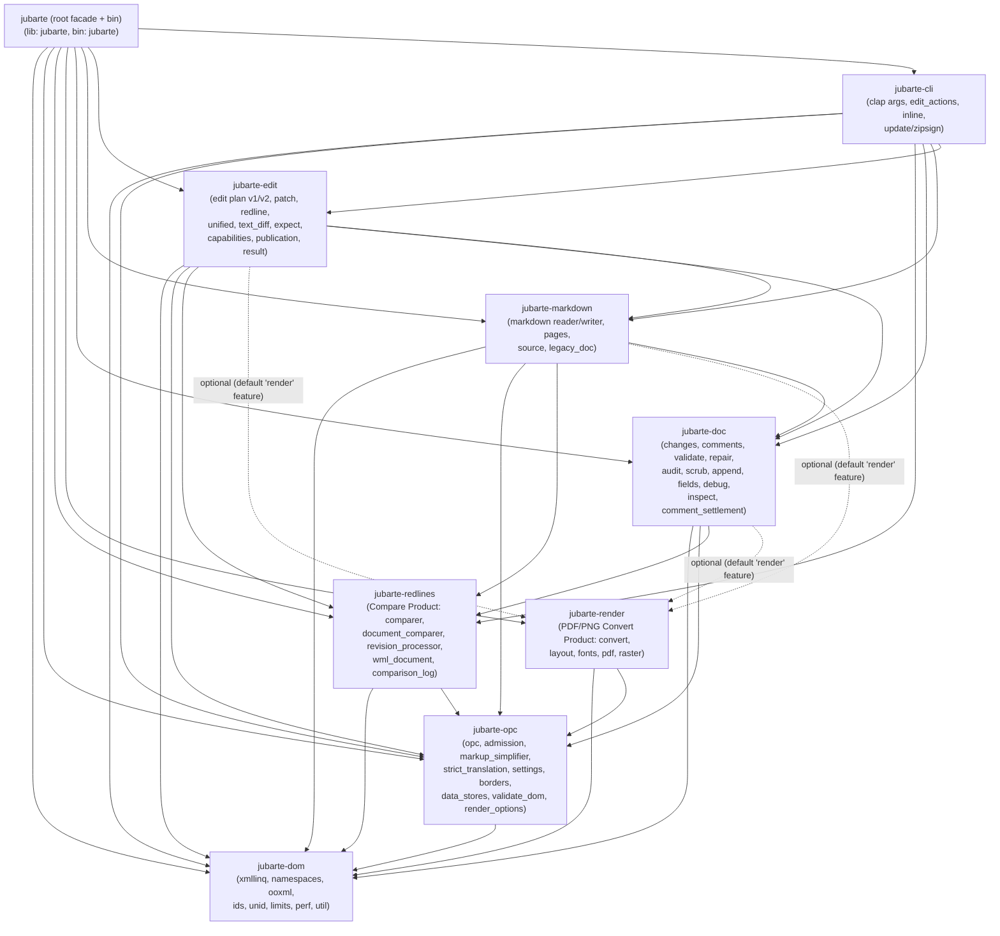

# Repository Reorganization, Crate Split & Optimization Plan (v4)

> **Status legend** (added 2026-11-14): `- [x]` = done, `- [ ]` = pending.
> "Done (in-crate)" means the code was extracted into the corresponding
> `src/` module (`src/limits.rs`, `src/ooxml.rs`, `src/util/datetime.rs`,
> `src/validate_dom.rs`, `src/admission.rs`, `src/markup_simplifier.rs`,
> `src/borders.rs`, `src/data_stores.rs`) and the original paths re-export it;
> the physical move into `crates/jubarte-*` happens in the crate-split phase.
> `tests/crate_layering.rs` enforces the target layering in the meantime.

## 1. Executive Summary & Architectural Goals

`jubarte-redlines` has evolved from a Word-mode document comparison library into a **315,000+ LOC Word `.docx` platform** encompassing comparison (`redlines`), DOCX-to-PDF/PNG layout and rendering (`convert`), document inspection/validation/repair/append/scrub/fields, Markdown/CriticMarkup round-tripping, agentic editing (`EditPlan`), and a full CLI (`jubarte`), plus Python (`jubarte-python`), WebAssembly (`jubarte-wasm`), and benchmark (`jubarte-rust-inproc`) bindings:

- **Single monolithic root crate**: Every consumer compiles all 315k LOC across 122 source files. Users who only want **compare (`redlines`)** must compile the 69k LOC PDF renderer (`rustybuzz`, `ttf-parser`, `tiny-skia`, `image`) and embed **17 MB of uncompressed TTF fonts (`Carlito`, `Liberation`)**. Conversely, users who only want **DOCX-to-PDF/PNG conversion** must compile the 92k LOC comparison/LCS engine and the 25k LOC agentic edit engine.
- **Hidden WASM `slim` bloat**: Because `src/markdown/mod.rs` (`page_texts`) unconditionally calls `crate::convert::render`, `jubarte-wasm`'s `node-slim` and `web-slim` builds still link the entire PDF renderer and embedded fonts (**23 MB `.wasm`**, identical in size to the full build!).
- **4 disconnected Cargo workspaces & 4 `Cargo.lock` files**: Root `Cargo.toml`, `jubarte-python`, `jubarte-wasm`, and `jubarte-rust-inproc` each maintain separate workspaces and lockfiles (`fuzz` is a 5th).
- **595 separate integration test binaries in `tests/*.rs`**: Cargo links 595 independent test executables (and compiles `tests/common/mod.rs` 222 separate times), causing massive link-time bottlenecks and `target/` bloat.
- **5 mega-files accounting for 153,000 LOC (48% of the codebase)**:
  - [src/convert/mod.rs](../../src/convert/mod.rs) (69,056 LOC)
  - [src/comparer/finalize.rs](../../src/comparer/finalize.rs) (35,346 LOC)
  - [src/comparer/lcs.rs](../../src/comparer/lcs.rs) (21,290 LOC)
  - [src/document_comparer.rs](../../src/document_comparer.rs) (14,961 LOC)
  - [src/edit.rs](../../src/edit.rs) (12,374 LOC)
- **Dependency & code redundancy**:
  - Dual `quick-xml` versions (`0.42` and `0.41` via `oxml-opc`), even though [src/opc/mod.rs](../../src/opc/mod.rs) only imports 4 trivial types (`Part`, `PartURI`, `Relationships`, `OpcError`) from `oxml-opc` ([docs/ZIP9_OXML_OPC_MIGRATION.md](../../docs/ZIP9_OXML_OPC_MIGRATION.md)).
  - `uuid` (`v4`) pulled into native builds solely for a temp filename random suffix in [src/publication.rs](../../src/publication.rs#L179).
  - Duplicate `include_bytes!` of `Carlito-*.ttf` and `LiberationSans-*.ttf` across two functions in [src/convert/font.rs](../../src/convert/font.rs#L397-L561).

---

## 2. Target Multi-Crate & Multi-Language Product Architecture

### 2.1 Crate Dependency DAG (Strictly Acyclic in Production AND `[dev-dependencies]`)

### 2.2 Workspace Crate Responsibilities & External Dependencies

| Crate | Path | Library Name | Purpose & Modules | External Dependencies |
| :--- | :--- | :--- | :--- | :--- |
| **`jubarte-dom`** | `crates/jubarte-dom` | `jubarte_dom` | Arena XML DOM (`xmllinq`), `namespaces`, `ooxml` (constants, `sect_rank`, `text_box_names`, `HIGHLIGHTS`), `ids`, `unid`, `limits` (`InputLimits`, `InputBudget`, `UnsupportedContentError`), `perf`, `util` (`datetime` including `utc_now_iso8601`, `source_sha256`, `decode_entities`, word tokens). | `quick-xml` (0.42), `foldhash`, `unicode-segmentation`, `unicode-properties`, `serde`, `serde_json`, `sha2`, `js-sys` (`wasm32-unknown-unknown` only) |
| **`jubarte-opc`** | `crates/jubarte-opc` | `jubarte_opc` | Native `zip 9` OPC package reader/writer (`opc`), `admission` (including `admit_package`), `markup_simplifier` (including `mc:AlternateContent` helpers), `strict_translation`, `settings`, `word_default_theme`, `builtin_styles`, `borders`, `data_stores`, `validate_dom` (9 pure DOM structural predicates), `render_options` (`PdfOptions`, `RenderRequest`, `RevisionStyle`, `RevisionPalette`, `RevisionColor`, `MarkLines`, `CommentPlacement`). | `jubarte-dom`, `zip` (9.0.5), `sha1`, `sha2`, `serde`, `serde_json` |
| **`jubarte-redlines`** | `crates/jubarte-redlines` | `jubarte_redlines` | **Standalone Compare / Redlines Product Crate**: `comparer`, `document_comparer`, `revision_processor`, `wml_document`, `comparison_log`, plus re-exported `dom`, `opc`, `admission`. Zero PDF/font dependencies. | `jubarte-dom`, `jubarte-opc`, `serde`, `serde_json`, `sha1`, `sha2`, `base64` |
| **`jubarte-render`** | `crates/jubarte-render` | `jubarte_render` | **Standalone Convert-to-PDF/PNG Product Crate**: `convert` (`docx_to_pdf`, `docx_to_png`, `render_docx`, `diff_render`, `PdfOptions`, `RevisionStyle`, layout engine, TTF subsetting, PDF writer, PNG rasterizer). Zero compare/edit dependencies. | `jubarte-dom`, `jubarte-opc`, `ttf-parser`, `rustybuzz`, `tiny-skia`, `image`, `flate2`, `serde`, `serde_json` |
| **`jubarte-doc`** | `crates/jubarte-doc` | `jubarte_doc` | Document operations: `changes` (including `accept_revisions_keeping_comments` / `reject_revisions_keeping_comments`), `comments`, `validate`, `repair`, `audit`, `scrub`, `append`, `fields`, `debug` (including `critic_literal`), `inspect`, `comment_settlement`. | `jubarte-dom`, `jubarte-opc`, `jubarte-redlines`, `jubarte-render` (optional via `render` feature), `serde`, `serde_json`, `sha2` |
| **`jubarte-markdown`** | `crates/jubarte-markdown` | `jubarte_markdown` | Markdown/CriticMarkup reader & writer (`markdown::from_docx`, `markdown::write`, `markdown::diff`, `markdown::pages`, `markdown::source`), `legacy_doc` (`.doc` OLE reader). | `jubarte-dom`, `jubarte-opc`, `jubarte-redlines`, `jubarte-render` (optional via `render` feature), `jubarte-doc`, `pulldown-cmark`, `similar`, `regex`, `base64`, `serde`, `serde_json`, `sha2` |
| **`jubarte-edit`** | `crates/jubarte-edit` | `jubarte_edit` | Agentic `EditPlan` v1/v2 (`edit`), Markdown patching (`markdown::patch`, `markdown::redline`, `markdown::unified`), `text_diff`, `expect`, `capabilities`, `publication`, `result`. | `jubarte-dom`, `jubarte-opc`, `jubarte-redlines`, `jubarte-render` (optional via `render` feature), `jubarte-doc`, `jubarte-markdown`, `schemars`, `similar`, `regex`, `serde`, `serde_json`, `sha2`, `cap-std` & `xattr` (non-wasm) |
| **`jubarte-cli`** | `crates/jubarte-cli` | `jubarte_cli` | Shared CLI parser & dispatch (`cli`, `cli::edit_actions`), typed inline action compiler (`inline`), `update` (`self_update` + `ed25519-dalek` zipsign). | `jubarte-{dom,opc,redlines,doc,markdown,edit}`, `clap`, `same-file`, `self_update` (optional), `ed25519-dalek` (optional) |
| **`jubarte`** | `.` (root) | `jubarte` (`bin: jubarte`) | **Umbrella Facade Crate & CLI Binary**: Re-exports the entire `jubarte::*` public surface with `#[doc(inline)]` and builds the `jubarte` binary. | `jubarte-*` (all library crates unconditionally linked; `default = ["cli", "fast-alloc", "self-update"]`), `mimalloc` (optional via `fast-alloc`) |

> [!NOTE]
> **Preserving `--no-default-features` & `crates.io` / `jubarte-app` Compatibility**:
> - On root `jubarte`, all library sub-crates (`jubarte-dom`, `jubarte-opc`, `jubarte-redlines`, `jubarte-render`, `jubarte-doc`, `jubarte-markdown`, `jubarte-edit`) remain unconditionally compiled in the library target, while `default = ["cli", "fast-alloc", "self-update"]` gates only the CLI/allocator/self-update dependencies. This guarantees `cargo clippy --all-targets --no-default-features` ([ci.yml:57](../../.github/workflows/ci.yml#L57)), `jubarte-app`, `fuzz`, and `scripts/check_no_network.py` continue to work without modification.
> - Rust users who want **compare only** (without PDF/fonts) depend on `jubarte-redlines`; users who want **convert to PDF/PNG only** (without compare/edit) depend on `jubarte-render`; users who want **the full suite** depend on `jubarte`.
> - For `crates.io` OIDC trusted publishing ([release.yml:472-518](../../.github/workflows/release.yml#L472-L518)), any newly created crate on `crates.io` (`jubarte-dom`, `jubarte-opc`, `jubarte-render`, `jubarte-doc`, `jubarte-markdown`, `jubarte-edit`, `jubarte-cli`, `jubarte`) must be published once with a `CARGO_REGISTRY_TOKEN` API token and have `jandira-tech/jubarte-redlines` (`release.yml`, environment `release`) registered in its `crates.io` *Settings → Trusted Publishers* prior to the first automated OIDC release.

### 2.3 WebAssembly (`jubarte-wasm`) Product Split & Subpath Exports (Shrinking `slim` from 23 MB to ~4 MB)

- [ ] **Granular Feature Flags on [jubarte-wasm/Cargo.toml](../../jubarte-wasm/Cargo.toml) & [jubarte-wasm/src/lib.rs](../../jubarte-wasm/src/lib.rs)** — *pending: `default = ["console-panic", "pdf"]` today; no `full`/`slim`/`redlines` features yet.*
  - `default = ["full", "console-panic"]`
  - `full = ["compare", "pdf", "doc", "markdown", "edit", "cli"]`
  - `slim = ["compare", "doc", "markdown", "edit", "cli"]` (compiles `jubarte-doc`, `jubarte-markdown`, `jubarte-edit` with `default-features = false` so `jubarte-render` and the 17 MB of uncompressed fonts are completely omitted, shrinking `node-slim`/`web-slim` from **23 MB to ~4 MB**!)
  - `redlines = ["compare"]` (pure compare/redlines product: `compareDocuments`, `acceptRevisions`, `rejectRevisions`, `getRevisions`)
  - `pdf` (standalone DOCX-to-PDF/PNG product: `docxToPdf`, `docxToPng`, `renderPdf`, `pdfPageCount`, `diffRender`)
  - Every `#[wasm_bindgen]` entrypoint and `#[cfg(test)]` test in [jubarte-wasm/src/lib.rs](../../jubarte-wasm/src/lib.rs) is gated by its corresponding feature (`compare`, `pdf`, `doc`, `markdown`, `edit`, `cli`; with `convert_markdown` gated by `#[cfg(all(feature = "pdf", feature = "markdown"))]`).
- [ ] **Subpath Exports & Module `package.json` Files in [jubarte-wasm/npm/](../../jubarte-wasm/npm/package.json)** — *pending.*
  - `jubarte-wasm` (`.` / `./node` / `./web`): Full `jubarte` WASM facade.
  - `jubarte-wasm/redlines` (`./node-redlines`, `./web-redlines`) and `jubarte-wasm/slim` (`./node-slim`, `./web-slim`): Redlines & document operations without PDF/fonts.
  - `jubarte-wasm/pdf` and `jubarte-wasm/convert` (`./node-pdf`, `./web-pdf`): Standalone DOCX-to-PDF/PNG converter without compare/edit.
  - Track `package.json` files inside `npm/node-redlines/`, `npm/node-pdf/` (`{"type": "commonjs"}`) and `npm/web-redlines/`, `npm/web-pdf/` (`{"type": "module", "sideEffects": ["./snippets/*"]}`) so Node ESM/CJS resolution in [jubarte-wasm/npm-smoke.mjs](../../jubarte-wasm/npm-smoke.mjs) succeeds.
- [ ] **Dual CLI Binaries in [jubarte-wasm/cli/package.json](../../jubarte-wasm/cli/package.json)** — *pending.*
  - Expose both `"jubarte": "bin/jubarte-redlines.mjs"` and `"jubarte-redlines": "bin/jubarte-redlines.mjs"` in `"bin"`.

### 2.4 Python (`jubarte-python`) Dual-Namespace & Product Submodules

Publishing 3 separate native PyO3 C-extension distributions on PyPI is not advisable (it would triple the 7-wheel CI build matrix to 21 wheels, duplicate the compiled `.abi3.so`/`.pyd` binary in memory when both are installed, and break PyPI OIDC trusted publisher binding). Instead:

- [ ] **Dual Top-Level Packages (`jubarte` and `jubarte_redlines`) + Product Submodules (`jubarte.redlines`, `jubarte.convert`)** — *pending.*
  - Add `jubarte-python/python/jubarte/` (`__init__.py`, `__main__.py`, `redlines.py`, `convert.py`, `py.typed`) alongside `jubarte-python/python/jubarte_redlines/`.
  - In [jubarte-python/pyproject.toml](../../jubarte-python/pyproject.toml), set `python-packages = ["jubarte_redlines", "jubarte"]` under `[tool.maturin]` so `maturin` bundles both top-level packages into every wheel!
  - Add `jubarte = "jubarte_redlines.__main__:main"` alongside `jubarte-redlines` and `jubarte-mcp` in `[project.scripts]`.
- [ ] **Granular Cargo Features in [jubarte-python/Cargo.toml](../../jubarte-python/Cargo.toml)** — *pending: `default = ["redlines", "render", "doc", "markdown", "edit", "cli"]` so source builds can compile minimal compare-only or PDF-only wheels on demand.*

---

## 3. Complete Cross-Crate Cycle & Upward-Call Elimination Matrix (Phase 1)

Every upward or peer cross-crate reference across all 122 files in `src/` (including `render`-disabled builds and inline `#[cfg(test)]` blocks) is resolved in Phase 1:

| # | Source File(s) & Line(s) | Current Target | Resolution | Status |
| :--- | :--- | :--- | :--- | :--- |
| **1** | `src/xmllinq/parse.rs:40`, `src/admission.rs:259` | `admission::InputLimits`, `document_comparer::UnsupportedContentError` | Move `InputLimits`, `InputBudget`, `InputLimitOverrides`, `AdmissionError`, `UnsupportedContentError` to `jubarte-dom::limits`; re-export in `admission` and `document_comparer`. | Done (in-crate): `src/limits.rs` created; `admission.rs` re-exports (`pub use crate::limits::{…}`), `document_comparer.rs` re-exports `UnsupportedContentError`. |
| **2** | `src/convert/mod.rs:777, 19217, 22569, 22605` | `document_comparer::admit_package`, `comparer::finalize::{choice_requires_understood, word_understands_namespace, resolve_alternate_content_with}` | Move `admit_package` to `jubarte-opc::admission` and the 3 `mc:AlternateContent` helpers to `jubarte-opc::markup_simplifier`; re-export at original paths. | Done (in-crate): `admit_package` now lives in `src/admission.rs` (`document_comparer.rs` keeps a `pub(crate)` wrapper); the 3 `mc:AlternateContent` helpers moved into `src/markup_simplifier.rs`. |
| **3** | `src/comparer/revisions.rs:186, 257, 378`, `src/changes.rs:1908..1929`, `src/changes/logical.rs:385`, `src/comments.rs:247..251`, `src/edit.rs:3284`, `src/edit/inline.rs:450`, `src/cli.rs:633`, `src/bin/jubarte.rs:3205..5500` | `changes::revision_date`, `convert::{utc_now_iso8601, timestamp_order_key, timestamp_with_offset, format_word_Timestamp, parse_iso_datetime, civil_from_days}` | Consolidate all ISO-8601 / Word datetime helpers (including `utc_now_iso8601` and its `wasm32` `js_sys::Date` branch) into `jubarte-dom::util::datetime`; re-export at original paths. | Done (in-crate): all helpers consolidated in `src/util/datetime.rs` (`parse_datetime`, `utc_now_iso8601`, `timestamp_order_key`, `timestamp_with_offset`, `revision_date`, `civil_from_unix_days`, etc.); `convert/mod.rs` re-exports `utc_now_iso8601`. |
| **4** | `src/comparer/mod.rs:387, 390`, `src/revision_processor.rs:1143`, `src/markdown/{from_docx/mod.rs:2094, view_stories.rs:1739, write.rs:1687}` | `edit::sections::sect_rank`, `inspect::text_box_names`, `edit::HIGHLIGHTS` | Move `sect_rank`, `text_box_names`, and `HIGHLIGHTS` to `jubarte-dom::ooxml`; re-export at original paths. | Done (in-crate): all three live in `src/ooxml.rs`; re-exported via `edit/sections.rs`, `inspect.rs`, `edit.rs`. |
| **5** | `src/comparer/parts.rs:188, 749`, `src/markdown/write.rs:1384, 1455` | `inspect::source_sha256`, `convert::altchunk::decode_entities` | Move `source_sha256` and `decode_entities` to `jubarte-dom::util`; re-export at original paths. | Done (in-crate): both in `src/util/mod.rs`. |
| **6** | `src/revision_processor.rs:4491`, `src/comparer/deleted_tables.rs:32`, `src/comparer/final_marks.rs:42..331`, `src/document_comparer.rs:618, 619, 8835` | 9 pure DOM predicates in `validate` (`has_unique_revision_id`, `inserted_text_before_deleted_tables`, `keeps_words`, `table_revised`, `uncovered_final_marks`, `container_blocks`, `revision_name`, `closing_paragraph`, `holds_page_field`) | Move these 9 pure DOM structural predicate functions into `jubarte-opc::validate_dom`; re-export in `jubarte-doc::validate`. | Done (in-crate): all 9 in `src/validate_dom.rs`; `validate.rs` re-exports (`pub(crate) use crate::validate_dom::…`). |
| **7** | `src/document_comparer.rs:5480-5496` | `changes::{accept_changes_keeping_comments, reject_changes_keeping_comments, ResolvedChanges, ChangeError}` | Move `accept_revisions_keeping_comments` and `reject_revisions_keeping_comments` to `jubarte-doc::changes`; re-export in `jubarte::document_comparer` in the root facade. | Pending — still defined in `src/document_comparer.rs`; awaits the `jubarte-doc` crate. |
| **8** | `src/changes.rs:1170, 1394` | `edit::KeptComment`, `edit::comment_settlement::AnchorChanges` | Move `src/edit/comment_settlement.rs` (`KeptComment`, `RemovedComment`, `AnchorChanges`) to `jubarte-doc`; re-export in `jubarte-edit`. | Pending — `src/edit/comment_settlement.rs` still in place. |
| **9** | `src/debug/render.rs:873..1015`, `src/validate.rs:2013`, `src/append.rs:1044`, `src/fields.rs:548..555`, `src/markdown/from_docx/mod.rs:3408..3428` | `markdown::{borders, data_stores, package::append_numbering}`, `convert::{roman_label, alpha_label, list_number, names_deeper_level, wrapped_children, cell_is_deleted, table_look}` | Move `borders.rs`, `data_stores.rs`, `append_numbering`, numbering label helpers, and DOM table helpers into `jubarte-opc`; re-export at original paths. | Partial — `borders.rs` and `data_stores.rs` moved to `src/` root (OPC layer) and `markup_simplifier.rs` gained the `mc:AlternateContent` helpers; `append_numbering` still in `markdown/package.rs`; `roman_label`/`alpha_label`/`list_number`/`names_deeper_level`/`wrapped_children`/`cell_is_deleted`/`table_look` still in `convert/mod.rs`. |
| **10** | `src/cli.rs:2894-2899, 3159`, `src/markdown/mod.rs:804, 1101, 1136`, `src/markdown/from_docx/mod.rs:916`, `src/fields.rs:79, 170, 257`, `src/debug/render.rs:1158-1162` | `convert::{PdfOptions, RenderRequest, RevisionStyle, RevisionPalette, RevisionColor, MarkLines, CommentPlacement, render, docx_render_report, layout_facts}` | Move the pure config/value types (`PdfOptions`, `RenderRequest`, `RevisionStyle`, `RevisionPalette`, `RevisionColor`, `MarkLines`, `CommentPlacement`) to `jubarte-opc::render_options` (re-exported in `jubarte-render` and `jubarte::convert`), and gate the actual layout calls in `fields.rs`, `debug/render.rs`, and `markdown::page_texts` behind `#[cfg(feature = "render")]`. | Pending — no `render_options` module exists; `PdfOptions` & friends still in `convert`. |
| **11** | `src/debug.rs:1808` | `text_diff::critic_literal` | Move `critic_literal` to `jubarte-doc::debug`; re-export in `jubarte-edit::text_diff`. | Pending — still in `src/text_diff.rs`. |
| **12** | `src/markdown/patch.rs`, `src/markdown/redline.rs`, `src/markdown/unified.rs` | `edit::{apply_plan, EditPlan, Others, ...}` | Place `patch.rs`, `redline.rs`, `unified.rs`, and `text_diff.rs` in `jubarte-edit`; re-export into `jubarte::markdown` in the root facade. | Pending — files still under `src/markdown/` and `src/text_diff.rs`. |
| **13** | `src/edit/inline.rs:12, 463` | `cli::{edit_actions::EditAction, Cli, Command}` | Move `src/edit/inline.rs` (already `#[cfg(feature = "cli")]`) to `jubarte-cli`; re-export `#[cfg(feature = "cli")] pub use jubarte_cli::inline;` in `jubarte::edit`. | Pending — `src/edit/inline.rs` still in place. |
| **14** | `src/comparer/finalize.rs:24548..27574`, `src/settings.rs:528`, `src/append.rs:1044` (`#[cfg(test)]`) | `validate::ring1`, `comments::list_comments`, `markdown::markdown_to_docx` | Extract those cross-crate integration unit tests to `tests/it_redlines/` and `tests/it_doc/` so `[dev-dependencies]` have zero cycles. | Pending — no `tests/it_*/` suites exist yet (see §6). |

### 3.1 Cross-Crate Visibility (`__private`), `#[doc(inline)]` & [scripts/api_snapshot.py](../../scripts/api_snapshot.py)

- [ ] **`#[doc(hidden)] pub mod __private`**: Internal helpers called across sub-crates (~158 items) are exported only through `#[doc(hidden)] pub mod __private` on each sub-crate. — *pending: no `__private` module exists yet.*
- [ ] **`#[doc(inline)]` on all root `jubarte` re-exports**: Every `pub use` / `pub mod` in the root `jubarte` facade carries `#[doc(inline)]` so `rustdoc --output-format json` includes re-exported external crate items inside `doc["index"]`. — *pending: no `#[doc(inline)]` in `src/lib.rs` yet.*
- [ ] **Two surgical updates in [scripts/api_snapshot.py](../../scripts/api_snapshot.py)**:
  - In `_walk` (lines 194–224): When walking an inlined re-export whose target originates in a workspace sub-crate (`paths[target_id]["crate_id"] != 0`), construct `walk_prefix` from the parent facade module's `prefix + (name,)` rather than `path_of(target_id)` so items moved to internal sub-crate modules (e.g. `jubarte_dom::limits::InputLimits`, `jubarte_opc::validate_dom::*`) always snapshot at their public facade path (`jubarte::admission::InputLimits`, `jubarte::validate::*`).
  - In `_public_surface` (lines 460–488): Skip any item whose `attrs` contains `doc(hidden)` so `#[doc(hidden)] pub mod __private` is never classified as `"api"`.

---

## 4. Dependency & Asset Optimization (Phase 2)

- [ ] **Retire `oxml-opc` and `quick-xml-041`** — *pending: `oxml-opc = 0.14.4` and `quick-xml-041` still in `Cargo.toml`.*
  - Replace the 4 types imported from `oxml-opc` in [src/opc/mod.rs](../../src/opc/mod.rs#L35) (`Part`, `PartURI`, `Relationships`, `OpcError`) with native types in `jubarte-opc` built on `zip 9.0.5` and `quick-xml 0.42` ([docs/ZIP9_OXML_OPC_MIGRATION.md](../../docs/ZIP9_OXML_OPC_MIGRATION.md)).
  - Removes `oxml-opc`, `quick-xml 0.41`, and transitive `chrono` from `Cargo.lock` and [deny.toml](../../deny.toml).
- [ ] **Remove `uuid`** — *pending: `uuid = { version = "1", features = ["v4"] }` still in `Cargo.toml`; `Uuid::new_v4()` still used at `src/publication.rs:578`.*
  - Replace `Uuid::new_v4()` in [src/publication.rs](../../src/publication.rs#L179) with a process-atomic counter + timestamp/PID + `RandomState` hash suffix.
- [ ] **Deduplicate Embedded Font Statics & Keep Root `assets/fonts/` Layout** — *partial: all production `include_bytes!` calls now live in the single `FontId::bytes()` match (`src/convert/font.rs:728`); remaining `include_bytes!` sites are in `#[cfg(test)]`. Still pending: named module-level `static` constants and the `crates/jubarte-render/assets/` copy.*
  - Define single module-level `static CARLITO_REGULAR: &[u8] = include_bytes!(...);` constants in `crates/jubarte-render/src/font.rs`.
  - Keep `assets/fonts/` (including `assets/fonts/extra/`), `schemas/`, and `keys/` at the repository root (and copy/symlink only the 16 embedded `Carlito-*` / `Liberation*` TTFs + OFL licenses into `crates/jubarte-render/assets/fonts/` and `schemas/edit-plan-v2.schema.json` into `crates/jubarte-edit/schemas/` for self-contained crate packaging) so [.github/workflows/release.yml](../../.github/workflows/release.yml#L161), [scripts/install.sh](../../scripts/install.sh#L34), [REUSE.toml](../../REUSE.toml), and [tests/release_metadata.rs](../../tests/release_metadata.rs) remain intact.

---

## 5. Decomposing the 5 Mega-Files (Phase 4)

- [ ] **`crates/jubarte-render/src/` (from [src/convert/mod.rs](../../src/convert/mod.rs) — 69,056 LOC)** — *pending: still a single 69k-LOC file.*
  - `lib.rs`, `model.rs`, `parse/{document,styles,tables,drawings,math,fields}.rs`, `layout/{engine,paragraph,line_break,table,float,footnote,header_footer,columns,revisions,balloons}.rs`, `font.rs`, `font_table.rs`, `pdf.rs`, `raster.rs`, `altchunk.rs`.
- [ ] **`crates/jubarte-redlines/src/comparer/finalize/` (from [src/comparer/finalize.rs](../../src/comparer/finalize.rs) — 35,346 LOC)** — *pending.*
  - `mod.rs`, `coalesce.rs`, `moves.rs`, `tables.rs`, `paragraph_marks.rs`, `formatting.rs`, `notes_comments.rs`, `ids_relationships.rs`, `sect_pr.rs`.
- [ ] **`crates/jubarte-redlines/src/comparer/lcs/` (from [src/comparer/lcs.rs](../../src/comparer/lcs.rs) — 21,290 LOC)** — *pending.*
  - `mod.rs`, `myers.rs`, `hierarchical.rs`, `word_level.rs`, `table_align.rs`, `similarity.rs`.
- [ ] **`crates/jubarte-redlines/src/document_comparer/` (from [src/document_comparer.rs](../../src/document_comparer.rs) — 14,961 LOC)** — *pending (a `src/document_comparer/` dir exists but the file is still ~15k LOC).*
  - `mod.rs`, `pipeline.rs`, `headers_footers.rs`, `footnotes_endnotes.rs`, `comments_part.rs`, `revisions_list.rs`, `accept_reject.rs`.
- [ ] **`crates/jubarte-edit/src/` (from [src/edit.rs](../../src/edit.rs) — 12,374 LOC)** — *pending.*
  - `lib.rs`, `plan.rs`, `anchor.rs`, `apply.rs`, `formatting.rs`, `tables_lists.rs`, `notes_images.rs`, plus existing submodules.

---

## 6. Careful AST/Symbol-Driven Test Classification & Consolidation (Phase 5)

All 595 files in `tests/*.rs` are classified by **actual AST/symbol imports, `#[global_allocator]` / process-global state, `CARGO_BIN_EXE_jubarte` usage, `#![cfg(feature = ...)]` attributes, and CI/script invocation**:

### 6.1 19 Standalone Top-Level Test Binaries (`tests/*.rs`)

- [ ] **3 Custom `#[global_allocator]` Tests** — *pending.*
  - [tests/perf_atom_clone_allocs.rs](../../tests/perf_atom_clone_allocs.rs), [tests/perf_serialize_prefix_allocs.rs](../../tests/perf_serialize_prefix_allocs.rs), [tests/foreign_alignment.rs](../../tests/foreign_alignment.rs)
- [ ] **1 Process-Global Atomic Perf Counter Test** — *pending.*
  - [tests/perf_contract.rs](../../tests/perf_contract.rs)
- [ ] **15 Named CI / Workflow / Repository-Metadata Gate Tests** — *pending.*
  - [tests/md_fixed_point.rs](../../tests/md_fixed_point.rs), [tests/adoption.rs](../../tests/adoption.rs), [tests/legacy_doc.rs](../../tests/legacy_doc.rs), [tests/legacy_doc_convert.rs](../../tests/legacy_doc_convert.rs), [tests/m_validity_ring1.rs](../../tests/m_validity_ring1.rs), [tests/coverage_gates.rs](../../tests/coverage_gates.rs), [tests/tuning_audit.rs](../../tests/tuning_audit.rs), [tests/release_metadata.rs](../../tests/release_metadata.rs), [tests/repo_paths_fit_windows.rs](../../tests/repo_paths_fit_windows.rs), [tests/schema_consistency.rs](../../tests/schema_consistency.rs), [tests/deny_build_scripts.rs](../../tests/deny_build_scripts.rs), [tests/readme_coverage.rs](../../tests/readme_coverage.rs), [tests/cli_version.rs](../../tests/cli_version.rs), [tests/bench_fixture_paths_resolve.rs](../../tests/bench_fixture_paths_resolve.rs), [tests/wasm_crate_is_self_contained.rs](../../tests/wasm_crate_is_self_contained.rs).

### 6.2 8 Consolidated Domain Test Suites (`tests/it_*/main.rs` — 576 files)

Classified deterministically by actual symbol/feature usage:

- [ ] **`tests/it_cli/main.rs` (~78 files)** — *pending.* Every remaining test that references `env!("CARGO_BIN_EXE_jubarte")`, `jubarte::cli::*`, or `jubarte::update::*`, or carries `#![cfg(feature = "cli")]` / `#![cfg(feature = "self-update")]`.
- [ ] **`tests/it_security/main.rs` (~18 files)** — *pending.* Non-CLI tests covering ZIP/XML bomb admission, data descriptors, malformed archives, duplicate parts, BOM handling, and Strict OOXML translation (`admission_data_descriptor`, `input_admission`, `m8_strict`, `strict_nested_text_box`, `customxml_nested_text_box`, `m13_bom`, etc.).
- [ ] **`tests/it_render/main.rs` (~4 files)** — *pending.* Non-CLI tests exercising `jubarte::convert::*` (`convert_alternate_content`, `convert_docx_to_png`, `convert_revision_palette`, `m_opc_explicit_close`). (Note: the 6 CLI-spawning `convert_*.rs` tests go into `it_cli` per Rule 1.)
- [ ] **`tests/it_edit/main.rs` (~44 files)** — *pending.* Non-CLI tests exercising `jubarte::edit::*`, `jubarte::text_diff::*`, `jubarte::expect::*`, or `jubarte::capabilities::*`.
- [ ] **`tests/it_markdown/main.rs` (~61 files)** — *pending.* Non-CLI, non-edit tests exercising `jubarte::markdown::*` (including `footnote_text_alias`, `docx_markdown_round_trip`, `docx_to_markdown_critic_markup`, `md_*`, `agent_view_attribution`).
- [ ] **`tests/it_doc/main.rs` (~15 files)** — *pending.* Non-CLI, non-edit, non-markdown tests exercising `jubarte::{changes,comments,validate,repair,audit,scrub,append,fields,debug,inspect}::*`.
- [ ] **`tests/it_redlines/main.rs` (~341 files)** — *pending.* Non-CLI tests exercising `jubarte-redlines` (`jubarte::{comparer,document_comparer,revision_processor}::*`, including the non-allocator `perf_*.rs` compare tests and `m32_word_alignment`).
- [ ] **`tests/it_dom_opc/main.rs` (~15 files)** — *pending.* Foundational DOM/OPC/simplifier/ID tests (`m0_comparator`, `m1_foundation`, `m2_markup_simplifier`, `id_types`, `m16_relationship_ids`, `m_part_rels_dangling`, `opc_relationships`, `package_relationship_carry`, `xml_descendant_search`, etc.).

### 6.3 Mandatory Mechanical Transformations for Consolidated Test Files & Moved `src/` Tests

- [ ] **`mod common;` $\rightarrow$ `use crate::common;` in-place**: Each `tests/it_<suite>/main.rs` declares `#[path = "../common/mod.rs"] mod common;` once at the root. In all 222 consolidated test files that contain `mod common;`, replace `mod common;` with `use crate::common;` **in-place** (preserving its position *after* any top-of-file `#![cfg(...)]` or `#![expect(...)]` inner attributes). — *pending.*
- [ ] **Prepend `../` to all 111 relative `include_bytes!` / `include_str!` calls in consolidated `tests/it_<suite>/*.rs` files**: Because `include_bytes!` / `include_str!` resolve paths relative to the invoking source file, moving `tests/foo.rs` to `tests/it_<suite>/foo.rs` requires prepending `../` to relative literal paths (`"fixtures/..."` $\rightarrow$ `"../fixtures/..."`, `"../docs/..."` $\rightarrow$ `"../../docs/..."`, and in `edit_permission_ranges.rs:1161` pointing `include_str!` to `../../crates/jubarte-edit/src/lib.rs`). — *pending.*
- [ ] **Update the 14 `#[cfg(test)]` `include_bytes!` and `CARGO_MANIFEST_DIR` paths inside `crates/*/src/`**: Add `../../` to relative `include_bytes!("../tests/...")` calls and `Path::new(env!("CARGO_MANIFEST_DIR")).join("../../tests/...")` inside `crates/*/src/` unit tests (`comparer/finalize.rs:33374`, `opc/archive.rs:1136`, `convert/font.rs:4700`, `convert/font_table.rs:450`, `document_comparer.rs:4241`, `inspect.rs:2088`, `edit.rs:3658`, `markdown/mod.rs:1503`, `markdown/from_docx/mod.rs:2651,2699`, `markdown/package.rs:1462`, `convert/mod.rs:3958..12770`, `update.rs:44`). — *pending (no `crates/*/src/` yet).*

---

## 7. Unified Workspace Configuration, CI, Scripts & Hygiene (Phase 6)

- [ ] **Unified Root Cargo Workspace ([Cargo.toml](../../Cargo.toml), `.cargo/config.toml`, `crates/jubarte-cli/build.rs`)** — *pending: root `[workspace]` is still empty; `jubarte-python`, `jubarte-wasm`, `jubarte-rust-inproc`, `fuzz` remain separate workspaces with their own lockfiles.*
  - `members = ["crates/*", ".", "jubarte-python", "jubarte-wasm", "jubarte-rust-inproc"]` and `exclude = ["fuzz"]`.
  - Root `[profile.release]` sets `strip = "none"` (protecting `jubarte-python` macOS Mach-O `LINKEDIT`).
  - Move `jubarte-wasm/.cargo/config.toml` `[target.wasm32-unknown-unknown]` `rustflags` into root `.cargo/config.toml`.
  - In `crates/jubarte-cli/build.rs`, resolve the `.git` directory across both `CARGO_MANIFEST_DIR` and `CARGO_MANIFEST_DIR/../..` so `JUBARTE_BUILD_VERSION` always includes `+<sha>`.
- [ ] **Gate Tests, Scripts & Workflows Updated** — *pending.*
  - [tests/coverage_gates.rs](../../tests/coverage_gates.rs): Allow `relative.starts_with("src") || relative.starts_with("crates")`, check `crates/*/src/lib.rs`, and walk `tests/**/*.rs` recursively.
  - [tests/tuning_audit.rs](../../tests/tuning_audit.rs) & [docs/TUNING_AUDIT.md](../../docs/TUNING_AUDIT.md): Scan `crates/jubarte-render/src/**/*.rs`.
  - [tests/bench_fixture_paths_resolve.rs](../../tests/bench_fixture_paths_resolve.rs): Scan `root.join("crates")` in addition to `src` and `tests`.
  - [tests/release_metadata.rs](../../tests/release_metadata.rs): Check font/image dependencies in `crates/jubarte-render/Cargo.toml` and root `Cargo.toml`/`Cargo.lock`.
  - [scripts/check_evidence_engine.py](../../scripts/check_evidence_engine.py) & `test_check_evidence_engine.py`: Add `"crates"` to `INPUTS` and check `crates/*/src/**/*.rs` and `crates/*/Cargo.toml`.
  - [scripts/check_engine_commit.sh](../../scripts/check_engine_commit.sh) & `test_check_engine_commit.py`: Add `crates` to `ENGINE_PATHS` and update `WASM_LOCK` handling for the unified workspace.
  - [scripts/check_no_network.py](../../scripts/check_no_network.py) & `test_check_no_network.py`: Scan `crates/*/src/` and `src/`, allowing network symbols only in `crates/jubarte-cli/src/update/`.
  - `tools/parity/build.sh`, `tools/parity/parity_check.py`, `tools/parity/test_parity_check.py`: Include `crates` in `SRC_DIRS` and input hashes.
  - [.github/workflows/ci.yml](../../.github/workflows/ci.yml) & [.github/workflows/release.yml](../../.github/workflows/release.yml) & [scripts/release.sh](../../scripts/release.sh): Use `cargo publish --workspace --dry-run` in CI/Step 7, publish workspace crates in topological order (`jubarte-dom` $\rightarrow$ $\dots$ $\rightarrow$ `jubarte-redlines` $\rightarrow$ $\dots$ $\rightarrow$ `jubarte`) checking `crates.io` per crate for idempotent resume, and normalize `src-tauri/Cargo.toml` in `app_test_gate`.
- [ ] **Root Directory Cleanup** — *pending: all listed files still at repo root.*
  - Move historical root markdown reports (`AUDIT_ISSUES.md`, `DOC_CONVERSION_ISSUES.md`, `ISSUE_TRIAGE_REPORT.md`, `PR_REVIEW_LOG.md`, `PR2017_FINAL_VERIFICATION.md`, `RELEASE_0.16.0_STATUS.md`, `ROUNDTRIP_ISSUES.md`, `SECURITY_ISSUES.md`) to `docs/archive/`, and `reproduce_issue.py` to `scripts/`.
