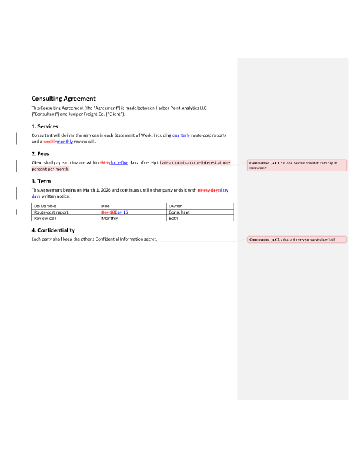
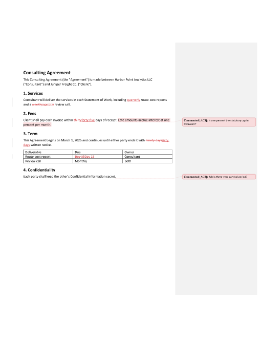
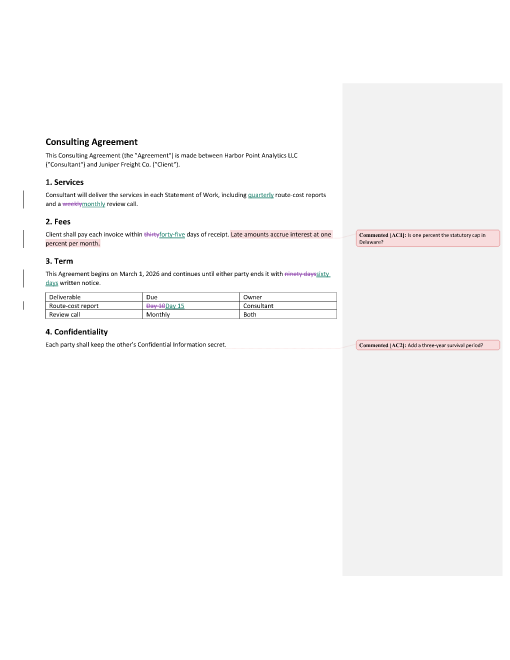
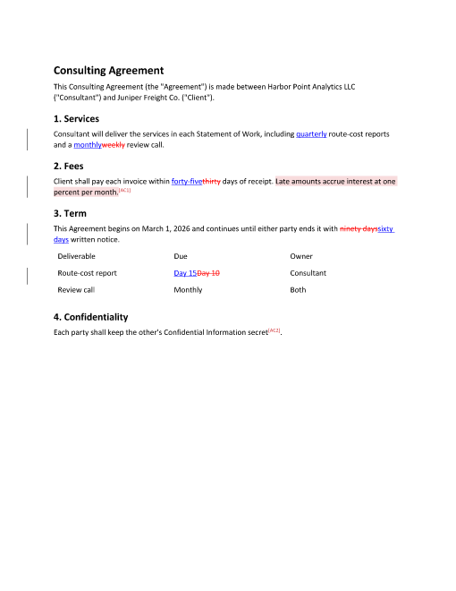
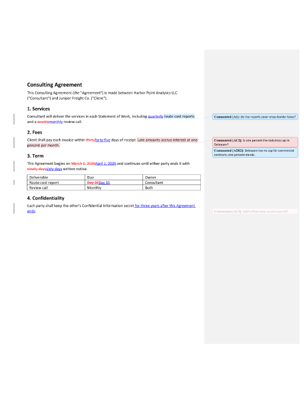
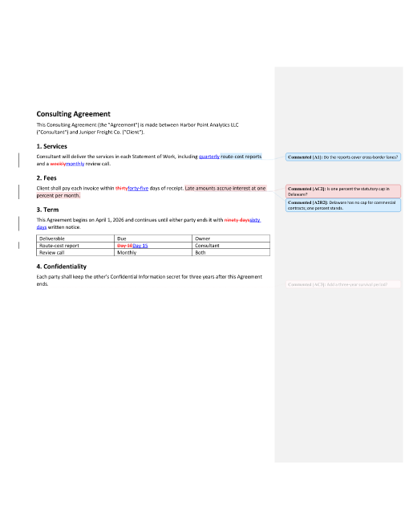
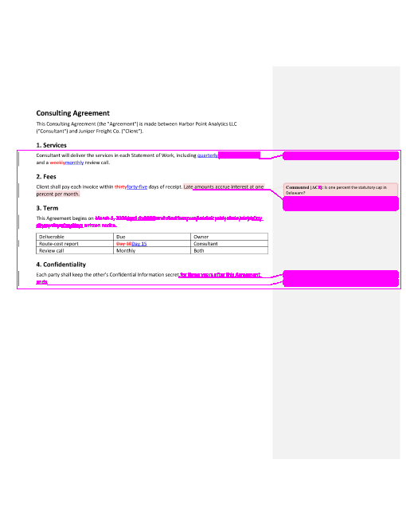
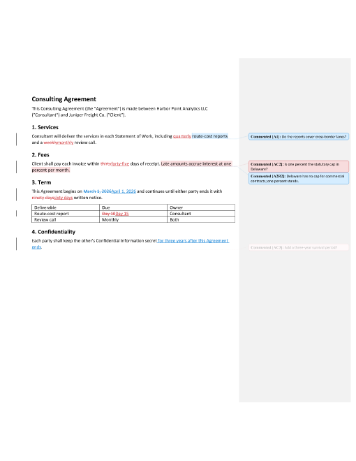
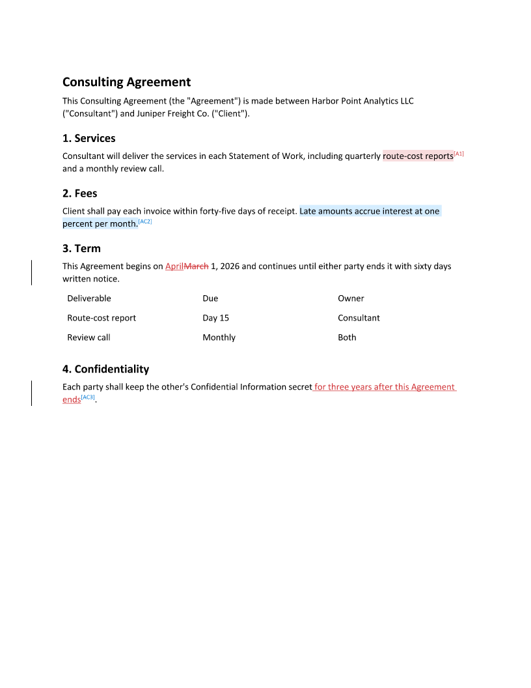

<!-- SPDX-FileCopyrightText: 2026 Jandira Technologies, LLC -->
<!-- SPDX-License-Identifier: AGPL-3.0-only -->

# How an agent sees documents with the jubarte CLI

Generated by `run.sh` from [`received.md`](received.md) and
[`plan.template.json`](plan.template.json); every block below is the real
output of the command above it. Do not edit by hand: rerun
`JUBARTE=path/to/jubarte bash examples/cli/visualize/run.sh`.
Every option of every command is listed in [`../help-cli.md`](../help-cli.md).

An agent has three kinds of eyes:

- **Text views** (`read`, `convert -t md`, `diff`, `changes`, `comments`):
  cheap, exact, greppable, and carry the IDs edits need.
- **Page views** (`convert -o x.png`/`x.pdf`, `edit --png`, `compare -o x.png`):
  what a person sees in Word, for layout, balloons and revision colours.
- **Machine views** (`--json` everywhere, `--report`, `visual-diff --json`):
  for checking a result instead of reading it.

The document is a consulting agreement that Ann Counsel already redlined:
nine tracked changes (insertions, deletions, a table cell change) and two
comments, built from CriticMarkup:

```bash
jubarte convert received.md -o out/received.docx --author "Ann Counsel" --datetime 2026-10-01T09:00:00Z
```

Pages are rendered at 60 dpi to keep this folder small; read them at 96 dpi
or more.

## 1. Visualize a document

### 1.1 Read it as text

The agent view: a YAML header (the file's `sha256:`, counts, authors and their handles, page setup, styles, headers and footers), then Markdown with the `<!-- pN -->` IDs an edit names, and every tracked change and comment as CriticMarkup with its ID (`r1+2`, `c5`).

```console
$ jubarte read out/received.docx
---
source: received.docx
sha256: 86e57bfaf2d3eb31415d89892c1402913e15850dd35ff95b5c9555fd56a62432
view: tracked                      # revisions as CriticMarkup, comments inline
track_changes: off                 # w:trackRevisions not set; new edits are not tracked unless edit sets it
revisions: 9                       # 9 marks shown as 6 changes: 2 insertions, 1 deletion, 3 substitutions
comments: 2 threads open           # 2 comments: c0, c1
authors:
  document_owner: none             # docProps/core.xml names no dc:creator or cp:lastModifiedBy
  AC: Ann Counsel                  # 9 revisions, 2 comments, 2026-10-01T09:00:00Z
body: p0-p18, 1 table, 1 page      # pages from layout
page: Letter portrait, margins 1in, header/footer 0.5in
styles:
  Normal: Calibri 11pt, after 8pt, line 1.08, left  # default; unannotated paragraphs use it
  "#": Heading1, Calibri bold 16pt, before 12pt, after 4pt, keep-next, keep-lines
  "##": Heading2, Calibri bold 14pt, before 12pt, after 4pt, keep-next, keep-lines
---

<!-- page 1 of 1 -->

<!-- p0 -->
# Consulting Agreement

<!-- p1 -->
This Consulting Agreement (the "Agreement") is made between Harbor Point Analytics LLC ("Consultant") and Juniper Freight Co. ("Client").

<!-- p2 -->
## 1. Services

<!-- p3 -->
Consultant will deliver the services in each Statement of Work, including {++quarterly++}{>>r1 @AC<<} route-cost reports and a {~~weekly~>monthly~~}{>>r3+2 @AC<<} review call.

<!-- p4 -->
## 2. Fees

<!-- p5 -->
Client shall pay each invoice within {~~thirty~>forty-five~~}{>>r5+4 @AC<<} days of receipt. {==Late amounts accrue interest at one percent per month.==}{>>c0 @AC: Is one percent the statutory cap in Delaware?<<}

<!-- p6 -->
## 3. Term
… (15 more lines)
```

`--track-changes accept`: the text as it reads once every change is accepted; the ID lines list what changed.

```console
$ jubarte read out/received.docx --track-changes accept
---
source: received.docx
sha256: 86e57bfaf2d3eb31415d89892c1402913e15850dd35ff95b5c9555fd56a62432
view: accept-all                   # 9 revisions by AC shown as accepted; file unchanged
track_changes: off                 # w:trackRevisions not set; new edits are not tracked unless edit sets it
revisions: 9                       # 9 marks shown as 6 changes: 2 insertions, 1 deletion, 3 substitutions
comments: 2 threads open           # 2 comments: c0, c1
authors:
  document_owner: none             # docProps/core.xml names no dc:creator or cp:lastModifiedBy
  AC: Ann Counsel                  # 9 revisions, 2 comments, 2026-10-01T09:00:00Z
body: p0-p18, 1 table, 1 page      # pages from layout
page: Letter portrait, margins 1in, header/footer 0.5in
styles:
  Normal: Calibri 11pt, after 8pt, line 1.08, left  # default; unannotated paragraphs use it
  "#": Heading1, Calibri bold 16pt, before 12pt, after 4pt, keep-next, keep-lines
  "##": Heading2, Calibri bold 14pt, before 12pt, after 4pt, keep-next, keep-lines
---

<!-- page 1 of 1 -->

<!-- p0 -->
# Consulting Agreement

<!-- p1 -->
This Consulting Agreement (the "Agreement") is made between Harbor Point Analytics LLC ("Consultant") and Juniper Freight Co. ("Client").

<!-- p2 -->
## 1. Services

<!-- p3 rev r1 @AC; r3+2 @AC -->
Consultant will deliver the services in each Statement of Work, including quarterly route-cost reports and a monthly review call.

<!-- p4 -->
## 2. Fees

<!-- p5 rev r5+4 @AC -->
Client shall pay each invoice within forty-five days of receipt. {==Late amounts accrue interest at one percent per month.==}{>>c0 @AC: Is one percent the statutory cap in Delaware?<<}

<!-- p6 -->
## 3. Term
… (15 more lines)
```

`--track-changes reject`: the text as it read before the changes.

```console
$ jubarte read out/received.docx --track-changes reject
---
source: received.docx
sha256: 86e57bfaf2d3eb31415d89892c1402913e15850dd35ff95b5c9555fd56a62432
view: reject-all                   # 9 revisions by AC shown as rejected; file unchanged
track_changes: off                 # w:trackRevisions not set; new edits are not tracked unless edit sets it
revisions: 9                       # 9 marks shown as 6 changes: 2 insertions, 1 deletion, 3 substitutions
comments: 2 threads open           # 2 comments: c0, c1
authors:
  document_owner: none             # docProps/core.xml names no dc:creator or cp:lastModifiedBy
  AC: Ann Counsel                  # 9 revisions, 2 comments, 2026-10-01T09:00:00Z
body: p0-p18, 1 table, 1 page      # pages from layout
page: Letter portrait, margins 1in, header/footer 0.5in
styles:
  Normal: Calibri 11pt, after 8pt, line 1.08, left  # default; unannotated paragraphs use it
  "#": Heading1, Calibri bold 16pt, before 12pt, after 4pt, keep-next, keep-lines
  "##": Heading2, Calibri bold 14pt, before 12pt, after 4pt, keep-next, keep-lines
---

<!-- page 1 of 1 -->

<!-- p0 -->
# Consulting Agreement

<!-- p1 -->
This Consulting Agreement (the "Agreement") is made between Harbor Point Analytics LLC ("Consultant") and Juniper Freight Co. ("Client").

<!-- p2 -->
## 1. Services

<!-- p3 rev r1 @AC; r3+2 @AC -->
Consultant will deliver the services in each Statement of Work, including  route-cost reports and a weekly review call.

<!-- p4 -->
## 2. Fees

<!-- p5 rev r5+4 @AC -->
Client shall pay each invoice within thirty days of receipt. {==Late amounts accrue interest at one percent per month.==}{>>c0 @AC: Is one percent the statutory cap in Delaware?<<}

<!-- p6 -->
## 3. Term
… (15 more lines)
```

`-p` reads only some blocks (`p3`, `p5-p7`, `t0`); `--comments none` moves the comment IDs onto the ID lines.

```console
$ jubarte read out/received.docx -p p5\,t0 --comments none
---
source: received.docx
sha256: 86e57bfaf2d3eb31415d89892c1402913e15850dd35ff95b5c9555fd56a62432
view: tracked, comments hidden     # 2 threads open (2 comments); carrying paragraphs are marked
track_changes: off                 # w:trackRevisions not set; new edits are not tracked unless edit sets it
revisions: 9                       # 9 marks shown as 6 changes: 2 insertions, 1 deletion, 3 substitutions
comments: 2 threads open           # 2 comments: c0, c1
authors:
  document_owner: none             # docProps/core.xml names no dc:creator or cp:lastModifiedBy
  AC: Ann Counsel                  # 9 revisions, 2 comments, 2026-10-01T09:00:00Z
body: p0-p18, 1 table, 1 page      # pages from layout
range: p5, t0 of p0-p18
page: Letter portrait, margins 1in, header/footer 0.5in
styles:
  Normal: Calibri 11pt, after 8pt, line 1.08, left  # default; unannotated paragraphs use it
  "#": Heading1, Calibri bold 16pt, before 12pt, after 4pt, keep-next, keep-lines
  "##": Heading2, Calibri bold 14pt, before 12pt, after 4pt, keep-next, keep-lines
---

<!-- page 1 of 1 -->

<!-- p5 comments c0 -->
Client shall pay each invoice within {~~thirty~>forty-five~~}{>>r5+4 @AC<<} days of receipt. Late amounts accrue interest at one percent per month.

<!-- t0 3x3, cells p8-p16 by row, header row repeats -->
|Deliverable|Due|Owner|
|-|-|-|
|Route-cost report|{~~Day 10~>Day 15~~}{>>r9+8 @AC<<}|Consultant|
|Review call|Monthly|Both|
```

### 1.2 Read it as Markdown with pages

`convert -t md`: CriticMarkup plus `<!-- page N of M -->` lines from the layout, so an agent knows which page text lands on.

```console
$ jubarte convert out/received.docx -t md
<!-- page 1 of 1 -->

# Consulting Agreement

This Consulting Agreement (the "Agreement") is made between Harbor Point Analytics LLC ("Consultant") and Juniper Freight Co. ("Client").

## 1. Services

Consultant will deliver the services in each Statement of Work, including {++quarterly++}{>>Ann Counsel (2026-10-01T09:00:00Z)<<} route-cost reports and a {~~weekly~>monthly~~}{>>Ann Counsel (2026-10-01T09:00:00Z)<<} review call.

## 2. Fees

Client shall pay each invoice within {~~thirty~>forty-five~~}{>>Ann Counsel (2026-10-01T09:00:00Z)<<} days of receipt. {==Late amounts accrue interest at one percent per month.==}{>>Ann Counsel (2026-10-01T09:00:00Z): Is one percent the statutory cap in Delaware?<<}

## 3. Term

This Agreement begins on March 1, 2026 and continues until either party ends it with {--ninety days--}{>>Ann Counsel (2026-10-01T09:00:00Z)<<}{++sixty days++}{>>Ann Counsel (2026-10-01T09:00:00Z)<<} written notice.

|Deliverable|Due|Owner|
|-|-|-|
|Route-cost report|{~~Day 10~>Day 15~~}{>>Ann Counsel (2026-10-01T09:00:00Z)<<}|Consultant|
|Review call|Monthly|Both|

## 4. Confidentiality

Each party shall keep the other's Confidential Information secret{>>Ann Counsel (2026-10-01T09:00:00Z): Add a three-year survival period?<<}.
```

`--no-page-markers` skips the layout pass; `--track-changes accept|reject` resolves the changes in the Markdown itself.

```console
$ jubarte convert out/received.docx -t md --no-page-markers --track-changes accept
# Consulting Agreement

This Consulting Agreement (the "Agreement") is made between Harbor Point Analytics LLC ("Consultant") and Juniper Freight Co. ("Client").

## 1. Services

Consultant will deliver the services in each Statement of Work, including quarterly route-cost reports and a monthly review call.

## 2. Fees

Client shall pay each invoice within forty-five days of receipt. Late amounts accrue interest at one percent per month.

## 3. Term

This Agreement begins on March 1, 2026 and continues until either party ends it with sixty days written notice.

|Deliverable|Due|Owner|
|-|-|-|
|Route-cost report|Day 15|Consultant|
|Review call|Monthly|Both|

## 4. Confidentiality

Each party shall keep the other's Confidential Information secret.
```

### 1.3 List what changed and who said what

`changes`: one line per tracked change, with the IDs (`r3`) that `accept --id`, `reject --id`, `edit -p r3 --accept` and edit plans select.

```console
$ jubarte changes out/received.docx
r1	insertion	text	Ann Counsel	p3	"quarterly"
r2	insertion	text	Ann Counsel	p3	"monthly"
r3	deletion	text	Ann Counsel	p3	"weekly"
r4	insertion	text	Ann Counsel	p5	"forty-five"
r5	deletion	text	Ann Counsel	p5	"thirty"
r6	deletion	text	Ann Counsel	p7	"ninety days"
r7	insertion	text	Ann Counsel	p7	"sixty days"
r8	insertion	text	Ann Counsel	p12	"Day 15"
r9	deletion	text	Ann Counsel	p12	"Day 10"
9 change(s)
```

`changes --json`: the same as JSON lines, with the long `id` and the short `ref`.

```console
$ jubarte changes out/received.docx --json
{"id":"body:rev:1","ref":"r1","kind":"insertion","target":"text","author":"Ann Counsel","date":"2026-10-01T09:00:00Z","text":"quarterly","paragraph":"body:p:3"}
{"id":"body:rev:2","ref":"r2","kind":"insertion","target":"text","author":"Ann Counsel","date":"2026-10-01T09:00:00Z","text":"monthly","paragraph":"body:p:3"}
{"id":"body:rev:3","ref":"r3","kind":"deletion","target":"text","author":"Ann Counsel","date":"2026-10-01T09:00:00Z","text":"weekly","paragraph":"body:p:3"}
{"id":"body:rev:4","ref":"r4","kind":"insertion","target":"text","author":"Ann Counsel","date":"2026-10-01T09:00:00Z","text":"forty-five","paragraph":"body:p:5"}
{"id":"body:rev:5","ref":"r5","kind":"deletion","target":"text","author":"Ann Counsel","date":"2026-10-01T09:00:00Z","text":"thirty","paragraph":"body:p:5"}
{"id":"body:rev:6","ref":"r6","kind":"deletion","target":"text","author":"Ann Counsel","date":"2026-10-01T09:00:00Z","text":"ninety days","paragraph":"body:p:7"}
{"id":"body:rev:7","ref":"r7","kind":"insertion","target":"text","author":"Ann Counsel","date":"2026-10-01T09:00:00Z","text":"sixty days","paragraph":"body:p:7"}
{"id":"body:rev:8","ref":"r8","kind":"insertion","target":"text","author":"Ann Counsel","date":"2026-10-01T09:00:00Z","text":"Day 15","paragraph":"body:p:12"}
{"id":"body:rev:9","ref":"r9","kind":"deletion","target":"text","author":"Ann Counsel","date":"2026-10-01T09:00:00Z","text":"Day 10","paragraph":"body:p:12"}
```

`comments`: comments, their anchors, replies and resolved state. `--json`, `--author NAME` and `--latest` (newest per thread) narrow it.

```console
$ jubarte comments out/received.docx
c0	p5	Ann Counsel	"Is one percent the statutory cap in Delaware?"	on "Late amounts accrue interest at one perc"
c1	p18	Ann Counsel	"Add a three-year survival period?"	on ""
2 comment(s)
```


```console
$ jubarte comments out/received.docx --json --author Ann\ Counsel
{"id":0,"ref":"c0","author":"Ann Counsel","initials":"AC","date":"2026-10-01T09:00:00Z","text":"Is one percent the statutory cap in Delaware?","done":false,"paragraph":"body:p:5","anchor_text":"Late amounts accrue interest at one percent per month.","before":"Client shall pay each invoice within forty-five days of receipt. ","after":""}
{"id":1,"ref":"c1","author":"Ann Counsel","initials":"AC","date":"2026-10-01T09:00:00Z","text":"Add a three-year survival period?","done":false,"paragraph":"body:p:18","anchor_text":"","before":"Each party shall keep the other's Confidential Information secret","after":"."}
```

### 1.4 Read the structure as data

`read --tables`: each table as a grid, with cell IDs.

```console
$ jubarte read out/received.docx --tables
table 0: 3x3 header_rows=1 widths=3120,3120,3120
p8=Deliverable	p9=Due	p10=Owner
p11=Route-cost report	p12=Day 15	p13=Consultant
p14=Review call	p15=Monthly	p16=Both
```

`read --json` (or `-o FILE.json`) writes the full snapshot (`schema_version`, `source_sha256`, `summary`, `paragraphs`, `stories`, `tables`, `controls`, `changes`, `comments`): [`out/read.json`](out/read.json). Its `source_sha256` is the value an edit plan pins.

`debug --check render`: what each story should put on the page (tables, fonts and what replaces them, revisions, sections).

```console
$ jubarte debug out/received.docx --check render
(layout): 1 pages
  pages 1
  font "Calibri" bold → Calibri-Bold explicit
  font "Calibri" regular → Calibri explicit
  font "Times New Roman" bold → TimesNewRomanPS-BoldMT explicit
  docDefaults rfonts ascii=Calibri cs=Calibri eastAsia=Calibri hAnsi=Calibri
word/comments.xml: 2 paragraphs
  pstyle "annotation text" ×2
word/document.xml: 19 paragraphs
  table 1 3x3 "Deliverable | Due | Owner"
  section 1 page=12240x15840 margins=1440,1440,1440,1440 header=720 footer=720
  pstyle "heading 1" ×1
  pstyle "heading 2" ×4
  revisions del→ins ×1 "This Agreement begins on March 1, 2026 a…"
  revisions ins→del ×3 "Consultant will deliver the services in …"
```

### 1.5 See the pages

`convert -o x.png`: every page as PNG (`x-page-01.png`, …), with `--report` (page count, each page's text, fonts) and `--font-report` (how each requested font resolved).

```console
$ jubarte convert out/received.docx --dpi 60 -o out/received.png --report out/received-report.json --font-report out/received-fonts.json --force
wrote out/received-page-NN.png (png, 1 page, 60 dpi)
```



Conventional marks (the default): deletions red and struck, insertions blue and underlined, moves green; comments in balloons on the right.

`--revisions word`: the markup Microsoft Word paints when it saves as PDF. Use it whenever the page is compared with one of Word's.

```console
$ jubarte convert out/received.docx --dpi 60 -o out/received-word.png --revisions word --force
wrote out/received-word-page-NN.png (png, 1 page, 60 dpi)
```



`--revisions custom --revision-palette`: pick each kind's colour and line (`strike`, `double-strike`, `underline`, `double-underline`, `plain`).

```console
$ jubarte convert out/received.docx --dpi 60 -o out/received-custom.png --revisions custom --revision-palette deleted=#8E44AD:double-strike\,inserted=#117A65:double-underline --force
wrote out/received-custom-page-NN.png (png, 1 page, 60 dpi)
```



`--move-comments`: comments listed after the last page; the commented text keeps its tint and a `[JR1]` marker, and the page keeps its own width.

```console
$ jubarte convert out/received.docx --dpi 60 -o out/received-endnotes.png --move-comments --force
wrote out/received-endnotes-page-NN.png (png, 2 pages, 60 dpi)
```




`-o x.pdf` (the default for Word) writes the PDF; `--compress` deflates its streams. `--pages 1` rasterizes only page 1 (layout still covers the whole document); `--changed-pages` keeps only the pages a change or a comment touches.

```console
$ jubarte convert out/received.docx --compress -o out/received-compressed.pdf --force
wrote out/received-compressed.pdf (pdf, 55297 bytes, 1 page)
```


```console
$ jubarte convert out/received.docx --pages 1 --changed-pages --dpi 60 -o out/received-changed.png --force
wrote out/received-changed-page-NN.png (png, 1 page, 60 dpi)
```

### 1.6 Check it before trusting it

`validate`: will Word open it without a repair prompt? (findings: exit 2)

```console
$ jubarte validate out/received.docx
no findings
```

`validate --rules a11y,style,structure`: accessibility, style and structure findings (an error: exit 2).

```console
$ jubarte validate out/received.docx --rules a11y\,style\,structure
no findings
```

## 2. Edit a document that already has tracked changes and comments

The agent answers Ann's comments and makes two edits of its own with an edit plan. `"existing_revisions": "keep"` keeps her nine changes as they are; the plan pins the `source_sha256` of `received.docx`, so it cannot be applied to another version of the file. The plan in this folder is [`plan.template.json`](plan.template.json) with that hash filled in.

`edit --dry-run`: resolve every operation and report, write nothing. A plan that cannot apply exits 3 with the reason.

```console
$ jubarte edit out/received.docx --plan out/plan.json --out-dir out/edited --dry-run
{"author":"Agent","base_sha256":"86e57bfaf2d3eb31415d89892c1402913e15850dd35ff95b5c9555fd56a62432","date":"2026-10-02T15:00:00Z","ev":"load","existing_revisions":"keep","guarded":true,"paras":19,"sha256":"86e57bfaf2d3eb31415d89892c1402913e15850dd35ff95b5c9555fd56a62432"}
{"at":"body:p:7","ctx":"Agreement begins on {March 1, 2026→April 1, 2026} and continues until","ev":"op","i":1,"id":"start-date","matches":1,"op":"replace","status":"ok"}
{"at":"body:p:18","ctx":"l Information secret{+ for three years after this Agreement ends}.","ev":"op","i":2,"id":"survival","matches":1,"op":"insert","status":"ok"}
{"at":"body:p:5","ctx":"comment 0","ev":"op","i":3,"id":"answer-cap","matches":1,"op":"reply_comment","status":"ok"}
{"at":"body:p:18","comment_id":1,"ctx":"comment 1","ev":"op","i":4,"id":"resolve-survival","matches":1,"op":"resolve_comment","status":"ok"}
{"at":"body:p:3","ctx":"including quarterly {#route-cost reports} and a monthly revie","ev":"op","i":5,"id":"ask-scope","matches":1,"op":"comment","status":"ok"}
{"comments":{"added":0},"ev":"summary","ops":{"failed":0,"ok":5},"paras":{"d":0,"from":19,"to":19},"revs":{"deleted":0,"format_changed":0,"inserted":0,"moved":0,"total":0},"status":"ok"}
```

`edit --pdf --png`: write `clean.docx` (every change accepted), `redline.docx` (Ann's changes plus the agent's), `patch.diff`, `report.jsonl`, and both as PDF and PNG.

```console
$ jubarte edit out/received.docx --plan out/plan.json --out-dir out/edited --pdf --png --dpi 60
{"comments":{"added":2},"ev":"summary","ops":{"failed":0,"ok":5},"paras":{"d":0,"from":19,"to":19},"revs":{"deleted":1,"format_changed":0,"inserted":2,"moved":0,"total":3},"status":"ok"}
wrote out/edited (8 files: clean.docx, redline.docx, patch.diff, redline.pdf, redline-page-01.png, clean.pdf, clean-page-01.png, report.jsonl)
---
source: out/edited/redline.docx
sha256: ab5e5b861dcedb28f5d15f4fca582fd6ea45dcfbcfeaa3d587a56c0fa189a6ff
view: tracked                      # revisions as CriticMarkup, comments inline
track_changes: off                 # w:trackRevisions not set; new edits are not tracked unless edit sets it
revisions: 12                      # 12 marks shown as 9 changes: 4 insertions, 2 deletions, 3 substitutions
comments: 2 threads open, 1 resolved  # 4 comments: c0 (+ reply c2), c1, c3
authors:
  document_owner: none             # docProps/core.xml names no dc:creator or cp:lastModifiedBy
  AC: Ann Counsel                  # 9 revisions, 2 comments, 2026-10-01T09:00:00Z
  A: Agent                         # 3 revisions, 2 comments, 2026-10-02T15:00:00Z
body: p0-p18, 1 table, 1 page      # pages from layout
range: changed by @A (p3, p5, p7, p18) of p0-p18
page: Letter portrait, margins 1in, header/footer 0.5in
styles:
  Normal: Calibri 11pt, after 8pt, line 1.08, left  # default; unannotated paragraphs use it
  "#": Heading1, Calibri bold 16pt, before 12pt, after 4pt, keep-next, keep-lines
  "##": Heading2, Calibri bold 14pt, before 12pt, after 4pt, keep-next, keep-lines
---

<!-- p3 -->
Consultant will deliver the services in each Statement of Work, including {++quarterly++}{>>r1 @AC<<} {==route-cost reports==}{>>c3 @A: Do the reports cover cross-border lanes?<<} and a {~~weekly~>monthly~~}{>>r3+2 @AC<<} review call.

<!-- p5 -->
Client shall pay each invoice within {~~thirty~>forty-five~~}{>>r5+4 @AC<<} days of receipt. {==Late amounts accrue interest at one percent per month.==}{>>c0 @AC: Is one percent the statutory cap in Delaware?<<}{>>c2 @A re c0: Delaware has no cap for commercial contracts; one percent stands.<<}

<!-- p7 -->
This Agreement begins on {--March 1, 2026--}{>>r10 @A<<}{++April 1, 2026++}{>>r11 @A<<} and continues until either party ends it with {--ninety days--}{>>r6 @AC<<}{++sixty days++}{>>r7 @AC<<} written notice.

<!-- p18 -->
Each party shall keep the other's Confidential Information secret{++ for three years after this Agreement ends++}{>>r12 @A<<}{>>c1 @AC resolved: Add a three-year survival period?<<}.
```





### 2.1 What the edit did, as text

`patch.diff`: only the paragraphs the plan touched, as `git diff --word-diff` with CriticMarkup comments:

```diff
--- a/received.docx
+++ b/received.docx	Agent	2026-10-02T15:00:00Z
@@ [body:p:3] @@
Consultant will deliver the services in each Statement of Work,
including quarterly {==route-cost reports==}{>>Agent
(2026-10-02T15:00:00Z): Do the reports cover cross-border lanes?<<} and
a monthly review call.

@@ [body:p:5] @@
Client shall pay each invoice within forty-five days of receipt. {==Late
amounts accrue interest at one percent per month.==}{>>Ann Counsel
(2026-10-01T09:00:00Z): Is one percent the statutory cap in
Delaware?<<}{>>Agent (2026-10-02T15:00:00Z): Delaware has no cap for
commercial contracts; one percent stands.<<}

@@ [body:p:7] @@
This Agreement begins on [-March 1, 2026-]{+April 1, 2026+} and
continues until either party ends it with sixty days written notice.

@@ [body:p:18] @@
Each party shall keep the other's Confidential Information secret{+ for
three years after this Agreement ends+}{>>Ann Counsel
(2026-10-01T09:00:00Z): Add a three-year survival period?<<}.
```

`report.jsonl`: one line per operation, then a summary (`status`, operations ok/failed, revisions and comments added):

```json
{"author":"Agent","base_sha256":"86e57bfaf2d3eb31415d89892c1402913e15850dd35ff95b5c9555fd56a62432","date":"2026-10-02T15:00:00Z","ev":"load","existing_revisions":"keep","guarded":true,"paras":19,"sha256":"86e57bfaf2d3eb31415d89892c1402913e15850dd35ff95b5c9555fd56a62432"}
{"at":"body:p:7","ctx":"Agreement begins on {March 1, 2026→April 1, 2026} and continues until","ev":"op","i":1,"id":"start-date","matches":1,"op":"replace","status":"ok"}
{"at":"body:p:18","ctx":"l Information secret{+ for three years after this Agreement ends}.","ev":"op","i":2,"id":"survival","matches":1,"op":"insert","status":"ok"}
{"at":"body:p:5","comment_id":2,"ctx":"comment 0","ev":"op","i":3,"id":"answer-cap","matches":1,"op":"reply_comment","status":"ok"}
{"at":"body:p:18","comment_id":1,"ctx":"comment 1","ev":"op","i":4,"id":"resolve-survival","matches":1,"op":"resolve_comment","status":"ok"}
{"at":"body:p:3","comment_id":3,"ctx":"including quarterly {#route-cost reports} and a monthly revie","ev":"op","i":5,"id":"ask-scope","matches":1,"op":"comment","status":"ok"}
{"engine":"jubarte 0.12.0","ev":"render","page_starts":{"clean":["Consulting Agreement"],"redline":["Consulting Agreement"]},"pages":{"clean":1,"redline":1}}
{"dir":"out/edited","ev":"save","outputs":[{"bytes":7362,"f":"clean.docx","sha256":"35ffde1c4b6f99bcfa25cb08be4cdf6b35129a453a5bb917f8db91f086b6d0ab"},{"bytes":7449,"f":"redline.docx","sha256":"ab5e5b861dcedb28f5d15f4fca582fd6ea45dcfbcfeaa3d587a56c0fa189a6ff"},{"bytes":986,"f":"patch.diff","sha256":"e840d511381828672456fdc6432fbeca784f7756103af5839241d1f735e3374f"},{"bytes":60499,"f":"redline.pdf","sha256":"10037b1f89750af8ed4511aa0b886223759bbd5e8d6de7510e43fe48b391dfc7"},{"bytes":24585,"f":"redline-page-01.png","sha256":"cceb37c4df9bd5b43877fee1757ec68d47bb897bc427e813e23b2e073d2241eb"},{"bytes":60305,"f":"clean.pdf","sha256":"683076396e27e5579b82a5da14047a685f02fe9a2e11b1c3425f919de0145244"},{"bytes":24164,"f":"clean-page-01.png","sha256":"a8803bfc206929bdaac809f437b88578cfe7adcf09438544c660a9ef0bd2983d"}]}
{"comments":{"added":2},"ev":"summary","ops":{"failed":0,"ok":5},"paras":{"d":0,"from":19,"to":19},"revs":{"deleted":1,"format_changed":0,"inserted":2,"moved":0,"total":3},"status":"ok"}
```

`changes` on the redline: the agent's revisions sit beside Ann's, each with its author.

```console
$ jubarte changes out/edited/redline.docx
r1	insertion	text	Ann Counsel	p3	"quarterly"
r2	insertion	text	Ann Counsel	p3	"monthly"
r3	deletion	text	Ann Counsel	p3	"weekly"
r4	insertion	text	Ann Counsel	p5	"forty-five"
r5	deletion	text	Ann Counsel	p5	"thirty"
r10	deletion	text	Agent	p7	"March 1, 2026"
r11	insertion	text	Agent	p7	"April 1, 2026"
r6	deletion	text	Ann Counsel	p7	"ninety days"
r7	insertion	text	Ann Counsel	p7	"sixty days"
r8	insertion	text	Ann Counsel	p12	"Day 15"
r9	deletion	text	Ann Counsel	p12	"Day 10"
r12	insertion	text	Agent	p18	" for three years after this Agreement ends"
12 change(s)
```

`comments` on the redline: the reply names its parent and the resolved comment says so.

```console
$ jubarte comments out/edited/redline.docx
c0	p5	Ann Counsel	"Is one percent the statutory cap in Delaware?"	on "Late amounts accrue interest at one perc"
c2	p5	Agent	"Delaware has no cap for commercial contracts; one percent st"	on "Late amounts accrue interest at one perc"	reply to c0
c1	p18	Ann Counsel	"Add a three-year survival period?"	on ""	resolved
c3	p3	Agent	"Do the reports cover cross-border lanes?"	on "route-cost reports"
4 comment(s)
```

`comments --latest`: one comment per thread, the newest.

```console
$ jubarte comments out/edited/redline.docx --latest
c2	p5	Agent	"Delaware has no cap for commercial contracts; one percent st"	on "Late amounts accrue interest at one perc"	reply to c0
c1	p18	Ann Counsel	"Add a three-year survival period?"	on ""	resolved
c3	p3	Agent	"Do the reports cover cross-border lanes?"	on "route-cost reports"
3 comment(s)
```

`read --changed --by Agent` on the redline: only the blocks carrying the agent's changes and comments.

```console
$ jubarte read out/edited/redline.docx --changed --by Agent
---
source: redline.docx
sha256: ab5e5b861dcedb28f5d15f4fca582fd6ea45dcfbcfeaa3d587a56c0fa189a6ff
view: tracked                      # revisions as CriticMarkup, comments inline
track_changes: off                 # w:trackRevisions not set; new edits are not tracked unless edit sets it
revisions: 12                      # 12 marks shown as 9 changes: 4 insertions, 2 deletions, 3 substitutions
comments: 2 threads open, 1 resolved  # 4 comments: c0 (+ reply c2), c1, c3
authors:
  document_owner: none             # docProps/core.xml names no dc:creator or cp:lastModifiedBy
  AC: Ann Counsel                  # 9 revisions, 2 comments, 2026-10-01T09:00:00Z
  A: Agent                         # 3 revisions, 2 comments, 2026-10-02T15:00:00Z
body: p0-p18, 1 table, 1 page      # pages from layout
range: changed by @A (p3, p5, p7, p18) of p0-p18
page: Letter portrait, margins 1in, header/footer 0.5in
styles:
  Normal: Calibri 11pt, after 8pt, line 1.08, left  # default; unannotated paragraphs use it
  "#": Heading1, Calibri bold 16pt, before 12pt, after 4pt, keep-next, keep-lines
  "##": Heading2, Calibri bold 14pt, before 12pt, after 4pt, keep-next, keep-lines
---

<!-- page 1 of 1 -->

<!-- p3 -->
Consultant will deliver the services in each Statement of Work, including {++quarterly++}{>>r1 @AC<<} {==route-cost reports==}{>>c3 @A: Do the reports cover cross-border lanes?<<} and a {~~weekly~>monthly~~}{>>r3+2 @AC<<} review call.

<!-- p5 -->
Client shall pay each invoice within {~~thirty~>forty-five~~}{>>r5+4 @AC<<} days of receipt. {==Late amounts accrue interest at one percent per month.==}{>>c0 @AC: Is one percent the statutory cap in Delaware?<<}{>>c2 @A re c0: Delaware has no cap for commercial contracts; one percent stands.<<}

<!-- p7 -->
This Agreement begins on {--March 1, 2026--}{>>r10 @A<<}{++April 1, 2026++}{>>r11 @A<<} and continues until either party ends it with {--ninety days--}{>>r6 @AC<<}{++sixty days++}{>>r7 @AC<<} written notice.

<!-- p18 -->
Each party shall keep the other's Confidential Information secret{++ for three years after this Agreement ends++}{>>r12 @A<<}{>>c1 @AC resolved: Add a three-year survival period?<<}.
```

### 2.2 What the edit did, as pages

`visual-diff`: which rendered pages moved, and where (different pages: exit 5). With `--out-dir`, each changed page is written as before, after and a magenta overlay.

```console
$ jubarte visual-diff out/received.docx out/edited/redline.docx --out-dir out/visual-diff --dpi 60 --force
page 1: 3.12% of pixels changed, box [23, 190, 501, 375]
1 of 1 page differ (wrote out/visual-diff)
[exit 5]
```



`visual-diff --json`: the same answer for a script (`changed_ratio`, `bbox`, `only_in`).

```console
$ jubarte visual-diff out/received.docx out/edited/redline.docx --json --dpi 60
{"a":"out/received.docx","b":"out/edited/redline.docx","dpi":60.0,"a_pages":1,"b_pages":1,"changed":1,"pages":[{"index":0,"changed_ratio":0.03120618,"bbox":[23,190,501,375]}]}
[exit 5]
```

`edit --revisions word`: the same plan, its redline painted as Word paints it.

```console
$ jubarte edit out/received.docx --plan out/plan.json --out-dir out/edited-word --png --dpi 60 --revisions word
{"comments":{"added":2},"ev":"summary","ops":{"failed":0,"ok":5},"paras":{"d":0,"from":19,"to":19},"revs":{"deleted":1,"format_changed":0,"inserted":2,"moved":0,"total":3},"status":"ok"}
wrote out/edited-word (6 files: clean.docx, redline.docx, patch.diff, redline-page-01.png, clean-page-01.png, report.jsonl)
---
source: out/edited-word/redline.docx
sha256: ab5e5b861dcedb28f5d15f4fca582fd6ea45dcfbcfeaa3d587a56c0fa189a6ff
view: tracked                      # revisions as CriticMarkup, comments inline
track_changes: off                 # w:trackRevisions not set; new edits are not tracked unless edit sets it
revisions: 12                      # 12 marks shown as 9 changes: 4 insertions, 2 deletions, 3 substitutions
comments: 2 threads open, 1 resolved  # 4 comments: c0 (+ reply c2), c1, c3
authors:
  document_owner: none             # docProps/core.xml names no dc:creator or cp:lastModifiedBy
  AC: Ann Counsel                  # 9 revisions, 2 comments, 2026-10-01T09:00:00Z
  A: Agent                         # 3 revisions, 2 comments, 2026-10-02T15:00:00Z
body: p0-p18, 1 table, 1 page      # pages from layout
range: changed by @A (p3, p5, p7, p18) of p0-p18
page: Letter portrait, margins 1in, header/footer 0.5in
styles:
  Normal: Calibri 11pt, after 8pt, line 1.08, left  # default; unannotated paragraphs use it
  "#": Heading1, Calibri bold 16pt, before 12pt, after 4pt, keep-next, keep-lines
  "##": Heading2, Calibri bold 14pt, before 12pt, after 4pt, keep-next, keep-lines
---

<!-- p3 -->
Consultant will deliver the services in each Statement of Work, including {++quarterly++}{>>r1 @AC<<} {==route-cost reports==}{>>c3 @A: Do the reports cover cross-border lanes?<<} and a {~~weekly~>monthly~~}{>>r3+2 @AC<<} review call.

<!-- p5 -->
Client shall pay each invoice within {~~thirty~>forty-five~~}{>>r5+4 @AC<<} days of receipt. {==Late amounts accrue interest at one percent per month.==}{>>c0 @AC: Is one percent the statutory cap in Delaware?<<}{>>c2 @A re c0: Delaware has no cap for commercial contracts; one percent stands.<<}

<!-- p7 -->
This Agreement begins on {--March 1, 2026--}{>>r10 @A<<}{++April 1, 2026++}{>>r11 @A<<} and continues until either party ends it with {--ninety days--}{>>r6 @AC<<}{++sixty days++}{>>r7 @AC<<} written notice.

<!-- p18 -->
Each party shall keep the other's Confidential Information secret{++ for three years after this Agreement ends++}{>>r12 @A<<}{>>c1 @AC resolved: Add a three-year survival period?<<}.
```



## 3. Diff two documents

Old is `received.docx`, new is the agent's `redline.docx`. Each view keeps both documents' tracked marks unless it says otherwise. `-a` and `-d` pin the author and date so this guide is reproducible; by default they are `Redline` and now. `diff` writes text only: `-o FILE` keeps it in a file, and the Word redline, its PDF and its pages are `compare`'s.

### 3.1 Text views

`--format patch` (the default): the changed paragraphs as `git diff --word-diff` with CriticMarkup comments and highlights. `--columns N` wraps it (0: no wrap).

```console
$ jubarte diff out/received.docx out/edited/redline.docx -a Agent -d 2026-10-02T15:00:00Z
--- a/out/received.docx
+++ b/out/edited/redline.docx	Agent	2026-10-02T15:00:00Z
@@ [body:p:3] @@
Consultant will deliver the services in each Statement of Work,
including quarterly {==route-cost reports==}{>>Agent
(2026-10-02T15:00:00Z): Do the reports cover cross-border lanes?<<} and
a monthly review call.

@@ [body:p:5] @@
Client shall pay each invoice within forty-five days of receipt. {==Late
amounts accrue interest at one percent per month.==}{>>Ann Counsel
(2026-10-01T09:00:00Z): Is one percent the statutory cap in
Delaware?<<}{>>Agent (2026-10-02T15:00:00Z): Delaware has no cap for
commercial contracts; one percent stands.<<}

@@ [body:p:7] @@
This Agreement begins on [-March-]{+April+} 1, 2026 and continues until
either party ends it with sixty days written notice.

@@ [body:p:18] @@
Each party shall keep the other's Confidential Information secret{+ for
three years after this Agreement ends+}{>>Ann Counsel
(2026-10-01T09:00:00Z): Add a three-year survival period?<<}.
```

`--format github`: a Git/GitHub unified diff of the two documents' text, tracked marks preserved; `-U N` sets the context lines.

```console
$ jubarte diff out/received.docx out/edited/redline.docx --format github
diff --git a/out/received.docx b/out/edited/redline.docx
--- a/out/received.docx
+++ b/out/edited/redline.docx
@@ -2,11 +2,11 @@
   ¶  Consulting Agreement
   ¶  This Consulting Agreement (the "Agreement") is made between Harbo…
   ¶  1. Services
-… {++quarterly++} route-cost reports and a {++monthly++}{--weekly--} re…
+… {++quarterly++} route-cost reports[c3] and a {++monthly++}{--weekly--…
   ¶  2. Fees
-…erest at one percent per month.[c0]
+…erest at one percent per month.[c0][c2]
   ¶  3. Term
-  ¶  This Agreement begins on March 1, 2026 and continues until either…
+  ¶  This Agreement begins on {--March 1, 2026--}{++April 1, 2026++} a…
   table
    row
     ¶  Deliverable
@@ -21,7 +21,9 @@
     ¶  Monthly
     ¶  Both
   ¶  4. Confidentiality
-…r's Confidential Information secret[c1].
+…r's Confidential Information secret{++ for three years after this Agre…
 [word/comments.xml]
   ¶  Is one percent the statutory cap in Delaware?
+  ¶  Delaware has no cap for commercial contracts; one percent stands.
   ¶  Add a three-year survival period?
+  ¶  Do the reports cover cross-border lanes?
```

`-U0`: changed lines only.

```console
$ jubarte diff out/received.docx out/edited/redline.docx --format github -U0
diff --git a/out/received.docx b/out/edited/redline.docx
--- a/out/received.docx
+++ b/out/edited/redline.docx
@@ -5 +5 @@
-… {++quarterly++} route-cost reports and a {++monthly++}{--weekly--} re…
+… {++quarterly++} route-cost reports[c3] and a {++monthly++}{--weekly--…
@@ -7 +7 @@
-…erest at one percent per month.[c0]
+…erest at one percent per month.[c0][c2]
@@ -9 +9 @@
-  ¶  This Agreement begins on March 1, 2026 and continues until either…
+  ¶  This Agreement begins on {--March 1, 2026--}{++April 1, 2026++} a…
@@ -24 +24 @@
-…r's Confidential Information secret[c1].
+…r's Confidential Information secret{++ for three years after this Agre…
@@ -26,0 +27 @@
+  ¶  Delaware has no cap for commercial contracts; one percent stands.
@@ -27,0 +29 @@
+  ¶  Do the reports cover cross-border lanes?
```

`--accept-changes`: accept both documents' changes first, so only the outcome differs.

```console
$ jubarte diff out/received.docx out/edited/redline.docx --format github --accept-changes
diff --git a/out/received.docx b/out/edited/redline.docx
--- a/out/received.docx
+++ b/out/edited/redline.docx
@@ -2,11 +2,11 @@
   ¶  Consulting Agreement
   ¶  This Consulting Agreement (the "Agreement") is made between Harbo…
   ¶  1. Services
-…luding quarterly route-cost reports and a monthly review call.
+…luding quarterly route-cost reports[c3] and a monthly review call.
   ¶  2. Fees
-…erest at one percent per month.[c0]
+…erest at one percent per month.[c0][c2]
   ¶  3. Term
-  ¶  This Agreement begins on March 1, 2026 and continues until either…
+  ¶  This Agreement begins on April 1, 2026 and continues until either…
   table
    row
     ¶  Deliverable
@@ -21,7 +21,9 @@
     ¶  Monthly
     ¶  Both
   ¶  4. Confidentiality
-…r's Confidential Information secret[c1].
+…r's Confidential Information secret for three years after this Agreeme…
 [word/comments.xml]
   ¶  Is one percent the statutory cap in Delaware?
+  ¶  Delaware has no cap for commercial contracts; one percent stands.
   ¶  Add a three-year survival period?
+  ¶  Do the reports cover cross-border lanes?
```

`--format word`: fresh word-level CriticMarkup after accepting ALL changes in both documents.

```console
$ jubarte diff out/received.docx out/edited/redline.docx --format word
…luding quarterly route-cost reports{++[c3]++} and a monthly review call.
…erest at one percent per month.[c0]{++[c2]++}
  ¶  This Agreement begins on {~~March~>April~~} 1, 2026 and continues until e…
…r's Confidential Information secret{++ for three years after this Agreeme…++}…
{++  ¶  Delaware has no cap for commercial contracts; one percent stands.++}
{++  ¶  Do the reports cover cross-border lanes?++}
```

`--format normal`: line addresses (`a`/`d`/`c`), `<` and `>` lines, no context.

```console
$ jubarte diff out/received.docx out/edited/redline.docx --format normal
5c5
< … {++quarterly++} route-cost reports and a {++monthly++}{--weekly--} re…
---
> … {++quarterly++} route-cost reports[c3] and a {++monthly++}{--weekly--…
7c7
< …erest at one percent per month.[c0]
---
> …erest at one percent per month.[c0][c2]
9c9
<   ¶  This Agreement begins on March 1, 2026 and continues until either…
---
>   ¶  This Agreement begins on {--March 1, 2026--}{++April 1, 2026++} a…
24c24
< …r's Confidential Information secret[c1].
---
> …r's Confidential Information secret{++ for three years after this Agre…
26a27
>   ¶  Delaware has no cap for commercial contracts; one percent stands.
27a29
>   ¶  Do the reports cover cross-border lanes?
```

`--format context`: old/new range blocks with `!`, `+` and `-` prefixes.

```console
$ jubarte diff out/received.docx out/edited/redline.docx --format context
*** out/received.docx
--- out/edited/redline.docx
***************
*** 2,12 ****
    ¶  Consulting Agreement
    ¶  This Consulting Agreement (the "Agreement") is made between Harbo…
    ¶  1. Services
! … {++quarterly++} route-cost reports and a {++monthly++}{--weekly--} re…
    ¶  2. Fees
! …erest at one percent per month.[c0]
    ¶  3. Term
!   ¶  This Agreement begins on March 1, 2026 and continues until either…
    table
     row
      ¶  Deliverable
--- 2,12 ----
    ¶  Consulting Agreement
    ¶  This Consulting Agreement (the "Agreement") is made between Harbo…
    ¶  1. Services
! … {++quarterly++} route-cost reports[c3] and a {++monthly++}{--weekly--…
    ¶  2. Fees
! …erest at one percent per month.[c0][c2]
    ¶  3. Term
!   ¶  This Agreement begins on {--March 1, 2026--}{++April 1, 2026++} a…
    table
     row
      ¶  Deliverable
***************
*** 21,27 ****
      ¶  Monthly
      ¶  Both
    ¶  4. Confidentiality
! …r's Confidential Information secret[c1].
  [word/comments.xml]
    ¶  Is one percent the statutory cap in Delaware?
    ¶  Add a three-year survival period?
--- 21,29 ----
      ¶  Monthly
      ¶  Both
    ¶  4. Confidentiality
… (6 more lines)
```

`--format side-by-side`: old and new in columns with `|`, `<` and `>` markers. Lines are cut to a 70-character window around the change; `--full-lines` shows them whole.

```console
$ jubarte diff out/received.docx out/edited/redline.docx --format side-by-side
  ¶  Consulting Agreement                                                    ¶  Consulting Agreement
  ¶  This Consulting Agreement (the "Agreement") is made between Harbo…      ¶  This Consulting Agreement (the "Agreement") is made between Harbo…
  ¶  1. Services                                                             ¶  1. Services
… {++quarterly++} route-cost reports and a {++monthly++}{--weekly--} re… | … {++quarterly++} route-cost reports[c3] and a {++monthly++}{--weekly--…
  ¶  2. Fees                                                                 ¶  2. Fees
…erest at one percent per month.[c0]                                     | …erest at one percent per month.[c0][c2]
  ¶  3. Term                                                                 ¶  3. Term
  ¶  This Agreement begins on March 1, 2026 and continues until either…  |   ¶  This Agreement begins on {--March 1, 2026--}{++April 1, 2026++} a…
  table                                                                      table
   row                                                                        row
    ¶  Deliverable                                                             ¶  Deliverable
    ¶  Monthly                                                                 ¶  Monthly
    ¶  Both                                                                    ¶  Both
  ¶  4. Confidentiality                                                      ¶  4. Confidentiality
…r's Confidential Information secret[c1].                                | …r's Confidential Information secret{++ for three years after this Agre…
[word/comments.xml]                                                        [word/comments.xml]
  ¶  Is one percent the statutory cap in Delaware?                           ¶  Is one percent the statutory cap in Delaware?
                                                                         >   ¶  Delaware has no cap for commercial contracts; one percent stands.
  ¶  Add a three-year survival period?                                       ¶  Add a three-year survival period?
                                                                         >   ¶  Do the reports cover cross-border lanes?
```


```console
$ jubarte diff out/received.docx out/edited/redline.docx --format side-by-side --full-lines -U0
  ¶  Consultant will deliver the services in each Statement of Work, including {++quarterly++} route-cost reports and a {++monthly++}{--weekly--} review call. |   ¶  Consultant will deliver the services in each Statement of Work, including {++quarterly++} route-cost reports[c3] and a {++monthly++}{--weekly--} review call.
  ¶  Client shall pay each invoice within {++forty-five++}{--thirty--} days of receipt. Late amounts accrue interest at one percent per month.[c0] |   ¶  Client shall pay each invoice within {++forty-five++}{--thirty--} days of receipt. Late amounts accrue interest at one percent per month.[c0][c2]
  ¶  This Agreement begins on March 1, 2026 and continues until either party ends it with {--ninety days--}{++sixty days++} written notice. |   ¶  This Agreement begins on {--March 1, 2026--}{++April 1, 2026++} and continues until either party ends it with {--ninety days--}{++sixty days++} written notice.
  ¶  Each party shall keep the other's Confidential Information secret[c1]. |   ¶  Each party shall keep the other's Confidential Information secret{++ for three years after this Agreement ends++}[c1].
                                                                         >   ¶  Delaware has no cap for commercial contracts; one percent stands.
                                                                         >   ¶  Do the reports cover cross-border lanes?
```

### 3.2 Word, PDF and page views

`compare -o x.docx`: a Word redline of old against new, every difference a tracked change by `--author`.

```console
$ jubarte compare out/received.docx out/edited/redline.docx -o out/compare.docx --force -a Agent -d 2026-10-02T15:00:00Z
wrote out/compare.docx (docx, 11482 bytes)
```

`compare --mode powertools`: Open-Xml-PowerTools' coarser paragraph-level redline instead of Word's.

```console
$ jubarte compare out/received.docx out/edited/redline.docx -o out/compare-powertools.docx --mode powertools --force -a Agent -d 2026-10-02T15:00:00Z
wrote out/compare-powertools.docx (docx, 8198 bytes)
```

`changes` on the comparison: what Compare marked.

```console
$ jubarte changes out/compare.docx
r4	insertion	text	Agent	p7	"April"
r5	deletion	text	Agent	p7	"March"
r6	insertion	text	Agent	p18	" for three years after this Agreement ends"
3 change(s)
```

`compare -o x.png`: the redline's pages, with every `convert` page option: `--revisions`, `--revision-palette`, `--move-comments`, `--changed-pages`.

```console
$ jubarte compare out/received.docx out/edited/redline.docx -o out/compare.png --force --revisions word --move-comments -a Agent -d 2026-10-02T15:00:00Z
wrote out/compare-page-NN.png (png, 2 pages, 96 dpi)
```



`compare -o x.pdf --changed-pages`: only the pages a change touches.

```console
$ jubarte compare out/received.docx out/edited/redline.docx -o out/compare-changed.pdf --force --changed-pages -a Agent -d 2026-10-02T15:00:00Z
wrote out/compare-changed.pdf (pdf, 168026 bytes, 1 page)
```

`debug A B --check text`: the two packages' paragraphs, only the lines that differ, with `{+inserted+}` and `[-deleted-]` runs.

```console
$ jubarte debug out/received.docx out/edited/redline.docx --check text
word/comments.xml: 2 lines differ
+B   ¶  Delaware has no cap for commercial contracts; one percent stands.
  ~
+B   ¶  Do the reports cover cross-border lanes?
word/document.xml: 4 lines differ
-A   ¶  Consultant will deliver the services in each Statement of Work, including {+quarterly+} route-cost reports and a {+monthly+}[-weekly-] review call.
+B   ¶  Consultant will deliver the services in each Statement of Work, including {+quarterly+} route-cost reports[c3] and a {+monthly+}[-weekly-] review call.
  ~
-A   ¶  Client shall pay each invoice within {+forty-five+}[-thirty-] days of receipt. Late amounts accrue interest at one percent per month.[c0]
+B   ¶  Client shall pay each invoice within {+forty-five+}[-thirty-] days of receipt. Late amounts accrue interest at one percent per month.[c0][c2]
  ~
-A   ¶  This Agreement begins on March 1, 2026 and continues until either party ends it with [-ninety days-]{+sixty days+} written notice.
+B   ¶  This Agreement begins on [-March 1, 2026-]{+April 1, 2026+} and continues until either party ends it with [-ninety days-]{+sixty days+} written notice.
  ~
-A   ¶  Each party shall keep the other's Confidential Information secret[c1].
+B   ¶  Each party shall keep the other's Confidential Information secret{+ for three years after this Agreement ends+}[c1].
```

### 3.3 Markdown on either side

The same views work on Markdown. Here the agent's version of the Markdown source is compared with Ann's; `--critic` reads the CriticMarkup as tracked changes instead of text.


```console
$ jubarte diff received.md out/agent.md --format github -U1
diff --git a/received.md b/out/agent.md
--- a/received.md
+++ b/out/agent.md
@@ -17,3 +17,3 @@
 
-This Agreement begins on March 1, 2026 and continues until either part…
+This Agreement begins on April 1, 2026 and continues until either part…
 it with {--ninety days--}{++sixty days++} written notice.
@@ -27,2 +27,2 @@
 
-…r's Confidential Information secret{>>Add a three-year survival period…
+…r's Confidential Information secret for three years after this Agreeme…
```


```console
$ jubarte diff received.md out/agent.md --format word
This Agreement begins on {~~March~>April~~} 1, 2026 and continues until either…
…r's Confidential Information secret{++ for three years after this Agreeme…++}…
```

`--format critic`: the whole new document as CriticMarkup (two Markdown documents only).

```console
$ jubarte diff received.md out/agent.md --format critic
# Consulting Agreement

This Consulting Agreement (the "Agreement") is made between
Harbor Point Analytics LLC ("Consultant") and Juniper Freight Co. ("Client").

## 1. Services

Consultant will deliver the services in each Statement of Work,
including \{++quarterly++\} route-cost reports and a \{~~weekly~\>monthly~~\} review call.

## 2. Fees

Client shall pay each invoice within \{~~thirty~\>forty-five~~\} days of receipt.
\{==Late amounts accrue interest at one percent per month.==\}\{>>Is one percent the statutory cap in Delaware?<<\}

## 3. Term

This Agreement begins on {~~March~>April~~} 1, 2026 and continues until either party ends
it with \{--ninety days--\}\{++sixty days++\} written notice.

| Deliverable | Due | Owner |
|---|---|---|
| Route-cost report | \{~~Day 10~\>Day 15~~\} | Consultant |
| Review call | Monthly | Both |

## 4. Confidentiality

Each party shall keep the other's Confidential Information secret{~~\{>>Add a~> for~~} three{~~-year survival period?<<\}~> years after this Agreement ends~~}.
```

`compare X.docx Y.md -o x.docx`: the Markdown's edits as tracked changes on the Word document.

```console
$ jubarte compare out/received.docx out/agent.md -o out/from-markdown.docx --force -a Agent -d 2026-10-02T15:00:00Z
wrote out/from-markdown.docx (docx, 10074 bytes)
```

## 4. Every visualization and its options

| View | Command | Options that change what is shown |
|---|---|---|
| Agent view with IDs | `read FILE` | `--track-changes accept\|reject`, `--comments none`, `-p`, `--head`, `--tail`, `--changed`, `--by`, `-o FILE.md` |
| Markdown with pages | `convert FILE -t md` | `--no-page-markers`, `--track-changes all\|accept\|reject`, `-o FILE` |
| Tracked changes | `changes FILE` | `--json` |
| Comments | `comments FILE` | `--json`, `--author NAME`, `--latest` |
| Structure | `read FILE --json` / `--tables` | `-o FILE.json` |
| Render triage | `debug FILE --check render` | `--check text\|runs\|xml\|changes\|…`, two files print only differences |
| Pages | `convert FILE -o x.png` / `x.pdf` | `--dpi`, `--pages`, `--revisions conventional\|word\|custom`, `--revision-palette`, `--move-comments`, `--changed-pages`, `--compress`, `--report`, `--font-report`, `--fail-on-substitution`, `--timeout` |
| Validity | `validate FILE` | `--rules word,a11y,style,structure`, `--strict`, `--repair`, `--json` (see `--help`) |
| Edit result | `edit FILE --plan P --out-dir D` | `--dry-run`, `--pdf`, `--png`, `--dpi`, `--revisions`, `--revision-palette`, `--quiet`; writes `patch.diff`, `report.jsonl`, `clean.*`, `redline.*` |
| Text diff | `diff OLD NEW` | `--format patch\|critic\|github\|word\|normal\|context\|side-by-side`, `-U N`, `--accept-changes`, `--full-lines`, `--columns N`, `-f md\|docx`, `-o FILE.md\|.txt\|.patch\|.diff` |
| Word redline | `compare OLD NEW -o x.docx` | `--mode word\|powertools`, `--detail-threshold`, `-a`, `-d`, `--reference-doc` |
| Redline pages | `compare OLD NEW -o x.pdf\|x.png` | every page option of `convert` |
| Pixel diff | `visual-diff A B` | `--out-dir`, `--json`, `--no-overlay`, `--dpi` |
| Package diff | `debug A B`, `debug diff A B` | `--check …`, `--raw` |

Which to reach for:

- To decide what to edit: `read` (IDs) and `changes`/`comments` (revision
  and comment IDs).
- To check an edit: `edit`'s `report.jsonl` (status), `patch.diff` (just the
  touched paragraphs), then `visual-diff` (did the layout move, exit 5).
- To show a person: `convert -o x.png` or `compare -o x.pdf`; add
  `--revisions word` whenever the page is compared with Word's.
- To review two versions: `diff --format github` for text, `--accept-changes`
  or `--format word` when only the final wording matters.
